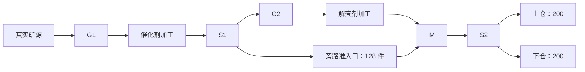

# Factory Engineering Scale V1

更新时间：2026-10-17

状态：D4-S0 合同已获萝卜SAMA批准实施。S0-A 身份 / 隔离、S0-B 布局 / 准备、S0-C 独立 Boot 恢复 / 中断与四档 12 秒前台初筛已通过，S0 完成；S1 四档各 450 秒持续验收亦已在 Apple M5 开发机通过。普通世界与验收预算保持。

## 用途与已确认决策

本篇细化 [D4 方案](../planning/factory-d3-exit-and-d4-validation.md)中的工程规模前置合同。推荐在现行 V5 生产、物流、电网与保存链路内增加一个严格隔离的工程身份，采用 20 个重复单元、100 台生产 / 仓储设备、1,000 段带。目标是证明这些真实系统在首档规模下仍可生产、诊断、保存与恢复；不新增玩家玩法，不将工程准备当作首程体验。检查级文档豁免开发闸门的新增玩家动作要求。

萝卜SAMA已确认以下整组决策，并要求先完成 S0-A，再推进布局与准备：

1. 保留 schema 5 字段结构，新增且只允许本篇定义的工程 ruleset / map / supply 三元组；普通 V5 身份、326 件供给及逐级升级保持。
2. 工程地图仍为 64×64，采用独立的全通行场坪与 20 个固定矿点，普通 / 富集各 10；没有普通地图矿壳屏障，但仍使用真实配方解锁与统计事实，不宣称覆盖勘探路径。
3. 首档 100 台改为 20 采集器、40 加工器、40 仓库；另加 40 电源、20 节点、40 分流器、20 汇合器、60 准入口。改变历史设备构成须明示；帧、单步及 30 分钟预算不降低。
4. 连续生产长测与高密度回压分开准备。前者要求 40 台加工器在每档都有真实完成与交付；后者允许停料 / 缺电的明确准备操作，证明拥塞运动与恢复，不拿它代替长测。

## 合同批准时的实现差异

| 当前约束 | 代码事实 | 提案处理 |
| --- | --- | --- |
| 普通身份与入口 | `codec.gd` 按 supply 选版本；V5 decoder 固定 AdmissionModel；`store.gd` 与新建菜单限定普通身份 | 增加精确工程三元组分派；工程创建只由专用检查入口调用，普通菜单不增加选项 |
| 地图与矿种 | `discovery_rules.gd` 只有 6 个矿点；`discovery_model.gd`、`power_grid.gd` 直接调用普通 open_cell；模型 / codec / 视图用 x 坐标判断富集 | 将地图通行、矿点矿种及矿壳展示收敛到已验证的地图身份；放置、碰撞、接电、近身操作、保存和视觉读取同一规则 |
| 连接列表 | `codec_v2.gd` 上限 91，来自普通 14 个电力节点的完全图 | 工程 60 节点上限 1,770；仍逐边校验端点、距离、通行、唯一排序与自动重建一致性 |
| 电量统计 | `statistics_validator.gd` 写死 240 kW 装机和 1,440 kW 请求上限 | 普通保持原值；工程分别为 4,800 / 3,600 kW，按供给合同校验所有历史桶、当前桶及累计量 |
| 物流能力分派 | `routing_world` 与准入口 validator 等按普通 supply 判断 | 使用严格身份对应的能力判定；审计 HUD、资产加载、摘要、codec，不把任意 supply 当作 V5 |
| 历史规模夹具 | schema 1 的 25×4 设备、40 带单元，备用反应器不工作，且无 V5 电力 / 多配方 | 保留旧入口，不改旧档版本或套用成绩；新夹具单列构成与工作率 |

表格保留合同批准时的差异依据；S0-A 已落实身份、地图查询、统计与入口隔离。布局与负载证据另行记录，不通过全局放大常量或复制模拟器绕过约束。

## 身份、保存与隔离

| 字段 | 已确认工程值 |
| --- | --- |
| world_kind / save_schema_version | `factory_3d / 5` |
| ruleset_id | `factory_engineering_admission_v1` |
| map_id | `factory_engineering_yard_64_v1` |
| supply_id | `factory_engineering_load_100_v1` |

上述工程身份已实现。继续沿用 V5 实体、发现、统计、自动电网、配额及时间字段；不增加自定义容量、虚假物品来源或可注入地图的任意字典。固定地图数据由版本化 map_id 决定，不写入存档。之所以建议保留 schema 5，是状态结构与同类字段含义保持，差异可由现有三个版本化身份完整表达；若实施发现必须增加状态字段或改变既有语义，退回审阅，再决定新 schema，不能硬塞进 V5。

- decoder 先验证完整三元组，再构造对应模型；只支持“普通完整三元组”与“工程完整三元组”，交叉拼接、未知身份或未来版本均致命拒绝，不进入旧备份回退。旧客户端因未知 ruleset / map 拒绝工程档；须实际补拒绝与主档不变测试。同 schema 的普通 / 工程备份也不互相恢复，不能只用版本号选择候选。
- 普通 create / continue / 2→3→4→5 升级不领取工程构件，不转换为工程世界。工程档无返回普通世界的转换入口；旧 schema 1 工程档亦不迁移。
- 专用 runner 强制仓库内忽略提交的双根目录、新 batch、新 world_id；拒绝生产 `user://`、软链接、持锁、已用批次。来源、代码指纹、准备 / 样本哈希与失败日志保留。
- 正式 Boot、Store 的锁、三槽备份、严格读回及原子发布照常使用。默认 Store / 菜单拒绝创建与继续工程身份；隔离检查初始化时显式启用工程上下文，再允许同一正式 Boot 继续。这个开关只限制入口可见性，不弱化 codec 校验，也不是防恶意修改的安全边界。
- 工程标题 / 检查准备页明确标注“工程规模验证”；不新增普通菜单中的工程选项、不修改普通存档根。工程快照误放默认目录时显示不支持，不自动删除或转换。

## 构件与电力预算

| 构件 | 每单元 | 20 单元总数 | 长测职责 |
| --- | ---: | ---: | --- |
| collector | 1 | 20 | 10 普通 / 10 富集矿源，真实缓冲与回压 |
| reactor | 2 | 40 | 10 基础催化剂、10 富集催化剂、20 解壳剂；没有备用空机冒充工作量 |
| storage | 2 | 40 | 每仓仍 200 件，合计 8,000 件容量 |
| belt | 50 | 1,000 | 全部接入声明的有向路径；配额用尽后支路可真实回压 |
| power_source | 2 | 40 | 每源 120 kW，可关闭；总装机 4,800 kW |
| power_junction | 1 | 20 | 6 格设备覆盖 / 12 格节点连接保持 |
| splitter / merger | 2 / 1 | 40 / 20 | 催化剂分配、两产物汇合、双仓分配 |
| admission_gate | 3 | 60 | 原矿筛选、加工进料、催化剂旁路本轮配额 |
| **合计** | **64** | **1,280** | 100 台生产 / 仓储 + 1,000 带 + 180 电力 / 附件 |

配置工作负载的同时请求上界为 `20×20 + 10×40 + 10×80 + 20×60 = 2,800 kW`；工程存档按任意合法配方的更宽上界 `20×20 + 40×80 = 3,600 kW` 校验，不能用当前布局的 2,800 拒绝合法改配方历史。装机不等于实际用电，空闲 / 缺料设备仍不请求功率。

离线几何得到 60 个电力节点、198 条自动可连边、一个网络，60 台用电设备均在真实覆盖范围内。1,770 是校验防护上限，不伪造 1,770 条实际边。每个固定步继续运行正式电网记账与物流；只允许既有的拓扑修订缓存，不预置 powered、不无限供电。

## 固定地图与单元坐标

全图边界仍为 `[-32,32)`。单元原点 `O(c,r)=(-30+15c,-30+12r)`，`c=0..3`、`r=0..4`；占用均落在 `[-30,30)`。单元矿点为 `O+(0,3)`；`(c+r)%2=0` 普通晶体，否则富集晶体。只能在这 20 个固定点放采集器，矿种由表决定；不按 x 坐标推断。外围保留角色 / 相机边界，建议初始审图落脚点 `(-31,-31)`，正式碰撞与服务路线仍须实现时验证。

以下坐标相对 O，机器保持现有固定朝向，方向 E / S / W / N 对应 `0/1/2/3`：

| 名称 | 左上格 / 朝向 |
| --- | --- |
| 采集器 / 催化剂加工 / 解壳剂加工 | `(0,3)` / `(5,0)` / `(5,6)`，均 E |
| 上仓 / 下仓 | `(11,5)` / `(11,8)`，均 E |
| 电源 A / B / 配电节点 | `(0,6)` / `(0,9)` / `(6,4)` |
| 催化剂分流 S1 / 成品汇合 M / 双仓分流 S2 | `(8,2)` / `(8,9)` / `(9,9)`，均 E |
| 原矿 G1 / 加工进料 G2 / 旁路 G3 | `(4,2)` E / `(4,8)` E / `(8,10)` N |

路径相邻拐点间逐格展开并包含端点；最后一格若是准入口，计附件而非 belt。普通带朝下一格，末格明确朝下游端口：

| 路径 | 拐点 | 带 / 闸 |
| --- | --- | --- |
| 采集器→催化剂加工 | `(2,4)→(2,1)→(1,1)→(1,0)→(4,0)→(4,1)→(3,1)→(3,2)→(4,2)`，末格 E | 12 / 1 |
| S1→解壳剂加工 | `(8,3)→(8,5)→(3,5)→(3,8)→(4,8)`，末格 E | 11 / 1 |
| S1→旁路→M | `(9,2)→(14,2)→(14,11)→(8,11)→(8,10)`，末格 N | 21 / 1 |
| 解壳剂加工→M | `(8,8)`，S | 1 / 0 |
| S2→上仓 | `(9,8)→(9,6)→(10,6)`，末格 E | 4 / 0 |
| S2→下仓 | `(10,9)`，E | 1 / 0 |

G1 允许该单元矿种、不限量；G2 允许催化剂、不限量；G3 允许催化剂、本轮 128 件，均允许接收。S1 将催化剂送加工或旁路；G3 用尽后旁路逐渐填满，S1 自然选择仍可接收的加工支路。M 接收解壳剂与旁路催化剂，S2 公平送两个仓。不存在自动出仓、货物销毁或周期清仓。

离线核算覆盖 1,280 个实体、2,100 个互不重叠占用格和 1,220 条定向物流连接；每个分流器恰有两个已接输出，其余输出不误接邻格。S0-B 已在正式模型复核相同结果及全部连接不跨单元，并通过实际碰撞移动到达全部 280 个非带设施；下文记录运行证据。工程移动不推进生产时间，不当作自然游玩时长。

## 准备、容量与工作负载

**来源**：新工程世界从零库存创建。先只布置一个普通矿单元，通过真实模型移动 / 拾样 / 加工 / 取放 / 开路命令完成唯一试制与 12 件消耗，保留合法统计与物料；再建满全部单元并配置。工程地图全通行不代表自动写入发现事实：passages 仍记录命令及耗材结果并参与解锁 / 统计校验，但不控制这张专用场坪的通行，属于工程 ruleset 的明确差异。这段仅是合法前置生成，不算自然勘探。样本位置与开路命令锚点沿当前规则，先完成前置再覆盖可能占用的场格；后续不重复拾样 / 开路。若该路径无法合法执行，修订准备布局，不伪造统计、外部取得普通物料或直接置 true。

前置剩余物料全部计入一个普通单元，限定不超过 80 件（含采集缓冲、输入 / 输出、在制投入、运输槽与仓 / 背包），并列出各类 / 等价值；不得含富集晶体，超出则合法消耗或重新生成，不丢弃。富集单元全量部署时必须零库存 / 零在制。全部形成后记录 `full_layout_start_tick`（证据清单字段，不写产品存档），真实模型显式推进 600 秒填完整历史；每个单元的完成、交付、G3 计数、各仓余量和电量分别记录。准备不计前台性能。

容量推导采用全量部署后最多 2,500 秒：600 秒准备 + 1,800 秒采样 + 最多 100 秒预热 / 阶段间生产。富集加工至多 `floor(2500/12)×3=624` 件催化剂；旁路最多 128，故累计终端入仓上界 `624/2+128/2=376` 件。双仓公平分配、无其他写入时每仓至多 188，仍留 12 格。普通单元按 250 催化剂算，终端上界 189；前置最多 80 件即使全计入同一仓，保守每仓上界 `ceil(189/2)+80=175`。普通配方不会把这批剩余物料扩成更多件；初始半批的额外产物也归该余量预算。须实测证明 S2 分配差不超过 1，不能只凭总容量宣布无满仓。

该推导是保守计数预算，不是吞吐实测。恢复与短探针在独立副本运行，不消费长测父档。任何富集单元初始夹带物料、超时、单仓分配异常或 450 秒内加工 / 收货停止，都使准备或该档失败；不能临时清仓、降低产率或缩短档位来保通过。

| 工况 | 生成与目的 | 必须记录 / 通过条件 |
| --- | --- | --- |
| W：持续生产 | 上述同一准备父档，四档连续各 450 秒；不在档间复位世界 | 每档 40 台加工器与 40 座仓都有完成 / 入仓；任意完整 120 秒内各加工器至少完成一次、各仓至少入仓一次，排除只在开头出一件；无满仓、缺电或计时积压；矿源按真实需要工作，不能称全部满速 |
| C：竞争与配额 | W 的准备与前段、另用新副本做双方待送验证 | 每个 S1 两支路与 M 两输入均有实际成功转移；真实共同争用与公平结果单列，不能仅凭接线推断。G3 的 127+持 1、用尽、停收排空与重置跨进程保持 |
| B：高密度回压 | 单独副本，合法改变 G3、填仓并真实推进生成拥塞；不计 W | 保持 100 台 / 1,000 带；记录普通带与附件占用分解，目标总在途 900–1,000。若需停料 / 关电稳定密度，必须记录，至少见货物实际转移与堵塞修复；不称持续加工性能 |
| R：拆改 / 电网 | W 独立副本，三次带段拆回重建、仅保留 1 个启用电源后再复源、节点调整 | 不丢货、错误对象不串线；在真实请求超过 120 kW 时见比例供能与缺口、复源恢复；保存重进继续，窗口原图及操作路径分列 |

物理运输槽位为 1,120（1,000 带 + 120 附件），原“最多 1,000 在途”的验证锚点仍按**全部运输设施内货物总数**计，不能把附件隐去。B 准备必须证明如何在不冻结货物、不删除物料的条件下留在 900–1,000：优先从原矿支路已满的真实拥塞副本停止 G1 新接收，记录并限制尚可转入运输槽的机器缓冲 / 在制量，再采集 30 秒自然物流与修复段；必要时有限关源，明确记作停料 / 缺电回压对照。若无法满足密度范围与运动证据则保持缺口。超过 1,000 的满槽压力可另提，不自动扩成本轮验收或换口径。此项是实施前置中需实际求证的风险，离线几何不作通过证据。

## 实施分包与退出证据

| 步骤 | 修改职责 | 退出条件 |
| --- | --- | --- |
| S0-A 身份与地图 | 固定工程数据、模型身份 / 能力与地图查询、codec / 统计上限、Store 显式工程上下文 | 普通 V1–V5 与旧二维规则保持；完整三元组严格接受、错配 / 未知 / 越额拒绝；自动电网重建、守恒、备份失败不写坏源档 |
| S0-B 布局与准备 | 专用布局 / 状态检查、合法前置生成、600 秒历史、Shell / PowerShell 共享 runner | 正式模型复核全部足印、端口、198 条预期边及服务路线；20 单元产出 / 电量 / 容量证明；B 密度方法实际成立 |
| S0-C 独立恢复与短窗 | 新副本写 / 读、半批半程与配额、失焦 / 关闭中断、正式 Boot 原图 | 完整首帧 / 同步数终点一致；新批次、来源不变、每段中断阻止后续；短窗 4 个尺寸 / 视距组合按原画质初筛 |
| S1 持续验收 | 复用已经审阅的正式采样器，明确工程来源与负载记录 | 四档各 450 秒、合计 1,800 秒前台；帧 p95 ≤16.7ms、模拟步 p95 ≤10ms、最大余量 <0.5 秒、时钟误差 ≤1e-5 秒、每次自动保存成功，且 W 工作负载判据通过 |

建议新增 `factory_engineering_*` 数据 / 检查模块及专用入口，名称在实现时定；不预写不存在的可运行命令。共享 `discovery_model`、`power_grid`、codec / statistics validator、view / HUD / Store 只做身份与地图边界需要的修改；不改配方耗时、带速、仓容、普通供给、渲染介质或调度公平性。修改共享能力判断后须定向覆盖普通 V5、旧版本及 A/B/C 关键路径，检查范围依据实际 diff 决定，不用整套历史窗口重跑替代风险分析。

存档拒绝矩阵至少包含：三个身份任一错配、普通世界伪装工程高库存、非法矿点 / 矿种、地图边界与人物碰撞、未知附件、构件不守恒、货物 / 配方 / 批次 / 配额非法、超限电量与图边、自动接入不一致、未来版本主档带旧备份、锁冲突和发布故障。所有拒绝均须证明无修复性清货、无序号偷增、无原主档覆盖。

S1 沿用窗口 / 最大化 × 局部 / 拉远四档，不缩分辨率或降画质；实际窗口、3D 与 PNG 像素单列，保留原始帧 / 步与自动保存尖峰，用户准备页手动开始，失焦 / 关闭停止全序列，不抢焦点或自动重开。统计叠层的规模性能若需验收，另作同状态短对照，不包含在四档默认结论。

## 风险、未决与审阅边界

- 实际规模可能暴露电网逐设备分配、物流候选和统计 UI 的热点；失败先记录瓶颈，不在本提案预授权算法重写或性能降级。
- 细密布局已补正式模型碰撞服务路线与四档原图；玩家是否能自行维护仍留亲测，不能用合法放置代签。
- W 后期旁路配额用尽会改变有效物流分布，逐档报告活跃 / 缺料 / 回压 / 在途数量，不能把 1,000 带称为同时满载运动。C 与 B 分别承担竞争和密度证据。
- B 的真实密度、显式模型时间下的工作率与固定前置已通过 S0-B；前台短窗与 Apple M5 的 S1 长测已分别通过，结果见下文。若失败需要改设备构成、地图、容量或验收口径，先更新提案再确认。
- D3 工程退出已于 2026-10-17 获批；亲测已接续，Windows 验证暂缓，目标硬件和玩法冻结项仍按原计划。原合同批准覆盖 S0 实现与定向验证；随后萝卜SAMA要求继续 S1，并确认现在安排长窗口，已提前告知并由用户手动开始。后续重跑仍须告知安排，不推送 / 打包 / 发布。

本轮证据：`tools/runtime-intake/check-runs/factory-engineering-scale-design-v1/contract-20261017-b/` 保留离线审计、脚本与布局清单。它使用提案中的全通行地图，不调用产品代码，不能替代 S0-A/B。首轮 a 暴露原矿路线从侧面接入单入口闸，已修正方向并保留失败记录；周志记录实际检查与批准状态。

## S0-A 实施与验证（2026-10-17）

- `engineering_rules.gd` / `engineering_model.gd` 固定供给、地图与矿种；普通 / 工程查询统一用于碰撞、放置、近身命令、电网、预览和视图。普通矿壳与上限保留，工程不绘制普通矿壳。
- V5 decoder 先校验完整身份组合；普通 / 工程交叉与未知值均致命拒绝。工程图边 / 历史电量采用本合同上限，自动图仍逐边重建比对。
- Store 默认拒绝工程创建 / 继续 / 保存，生产默认根即使显式启用也不接受；隔离 Boot 显式传入工程上下文，菜单不增加工程新建项。会话身份禁止普通 / 工程互转，备份选择校验同 schema 的完整身份。
- `sh tools/check-factory-engineering.sh identity <new-batch>` 与 `identity-read <new-batch> <parent-batch>` 共用 Python runner，PowerShell 包装入口同参数。批次、父来源 / 代码哈希、锁、软链接和拒绝结果严格保留；这两个模式只覆盖 S0-A，后续准备 / 性能模式分列。
- 最终批次 `s0-a-identity-20261017-e`：152 条断言通过，包括正式隔离 Boot；子批次 `s0-a-read-20261017-e`：3 条跨进程首帧 / 20 步轨迹断言通过，父档不变。原始目录为 `tools/runtime-intake/check-runs/factory-engineering-scale-v1/`。
- 普通 V5 准入口 461 条、V4→V5 正式菜单 10 条、范围电网 84 条、统计 29 条、基础 Store 故障 / 恢复 44 条回归通过。静态客户端检查通过。主机无窗口验证不代替原图或用户亲测；PowerShell 未执行。
- 首轮 a 发现 JSON 数字读回影响身份数组比较，已规范化 schema 数值后复验；c 正式 Boot 遇沙箱系统字体错误，完整保留失败日志，授权主机重跑通过，未忽略字体错误。

## S0-B / C 准备与恢复证据（2026-10-17）

所有批次在 `tools/runtime-intake/check-runs/factory-engineering-scale-v1/`，入口与准确参数见 [Tools](../../tools/README.md#正式工厂定向检查)。本步新增布局、准备、只读观察器、负载探针与独立 Boot 检查；S0-A 后未再改产品模型、配方、仓容、调度或画质。

| 批次 | 实际范围与结果 |
| --- | --- |
| `s0-b-prepare-20261017-e` | 2,208 条通过；零库存世界合法拾样、24 批基础催化剂、12 批解壳剂、实际消耗 12 件开路；前置剩余仅首个普通采集器 50 晶体、背包空。建满 1,280 实体后其余 19 单元零库存，真实显式 600 秒、完整历史，正式 Store 发布并释放锁 |
| `s0-b-read-20261017-e` | 3 条通过；新进程完整初态与 20 步轨迹一致 |
| `s0-b-capacity-20261017-d` | 460 条通过；同一模型连续四段 450 秒再 100 秒，加父档准备共 2,500 秒。每段 40 加工器 / 40 仓均有实际事件，最大事件间隔 41.25 秒，最大单仓 157 / 200，电量缺口累计 0；显式时间，不计前台性能 |
| `s0-b-competition-20261017-e` | 22 条通过；真实 127+持 1、停收持货、128 用尽排空、显式重置；合法临时拆下游形成两次同时争用，M 两输入各胜一次 |
| `s0-b-repair-20261017-d` | 182 条通过；三处带拆回重建保留物料，错误对象不改变快照；39 源关闭后真实请求超 120 kW 并比例供能，复源及节点迁回后恢复 198 边、4,800 kW、无缺口 |
| `s0-b-density-20261017-f` | 225 条通过；空载 G3 改不限量后真实生产至 910 在途，仓库及加工器输入均无剩余空位；G1 停收、40 有限源关闭。保守范围 910–950，30 秒显式物流稳定 910 件、98 次转移；三次持货带修复各 5 秒保持 909–910 件、各 11 次转移。最终普通带 800 + 附件 110，回收的 3 催化剂保留背包，非持续加工性能 |
| `s0-c-checkpoint-{prepared,repair,competition}-20261017-a`、`s0-c-checkpoint-density-20261017-b` | 分别 3 / 6 / 15 / 3 条通过；独立进程生成共 9 个检查点的完整 20 步预期 |
| `s0-c-boot-{prepared,repair,competition}-20261017-a`、`s0-c-boot-density-20261017-b` | 分别 6 / 12 / 30 / 6 条通过；正式隔离 Boot 首帧不让出进程帧即暂停，完整初态与续跑终点一致；实际保存内容比对及退出释放锁 |
| `s0-c-interrupt-{before,sampling,close}-20261017-a` | 无窗口合成事件，三个边界均通过；采样中先有真实固定步与保存，保留原始部分样本，所有后续阶段被阻止。不是前台成绩 |

600 秒准备与容量观察逐步记录每台完成 / 入仓、S1 两出口、M 两入口及 S2 实际分配。S2 分配差最大 1；两条入仓路线长短不同，使瞬时到仓差可达 2，不能把到仓顺序误写成分配失衡。固定 120 秒段与逐事件最大间隔同时核验；容量探针父档 d 与最终 e 使用同一产品 / 布局，e 只补跨单元边审计与证据治理，没有更换容量合同。

runner 对正式 factory / data / boot 脚本与固定布局核对状态兼容指纹，逐次另存实际运行脚本和场景指纹；消费者新增或报告代码变更不伪装为产品改变。所有运行检查父目录完整哈希前后不变、成功断言、ready、进程 / 日志、锁 / 软链和命名模式；新批次对各检查点保存完成时哈希。历史 repair d 的 `deficit.json` / `endpoint.json` 在 checkpoint 消费时补采，manifest 明示 `late_artifact_hash_capture`，不追改原批次。10 项 Python 边界测试通过。

失败保留：准备 a 的局部变量类型修正；b 曾误以瞬时到仓差代替 S2 分配差；c 的读回期望沿用固定 world_id，已改为新建随机身份。密度 d 达到 901–910 件，但一处选中空带无法证明修复转移，保留失败后改选三处确实持货的带，e 的实际轨迹通过；收尾审查再将停电后可吸收物料的加工器输入空位计入候选下界，f 复验通过。没有丢货、改仓容、注入货物或放宽验收门槛。

## S0-C 前台短窗与原图

批次 `s0-c-window-20261017-a` 从准备 e 的未消费副本启动。用户点击准备页后同一世界连续运行四档各 12 秒，32 条断言通过、无失焦；采用原采样器与原画质。实际碰撞移动 960 步经 61 个网格中心到 `(-4.5,1.5)` 后固定相机，没有写人物坐标。Apple M5、Godot 4.7 stable、Forward+；正式 Boot 完整首帧与父档一致。

| 档位 | 帧数 / 固定步 | 帧 p95 / p99 / 最大值（ms） | 单步 p95（ms） | 实际入仓 | 显式保存（ms） |
| --- | --- | --- | --- | --- | --- |
| 窗口 / 局部 | 1,440 / 240 | 10.677 / 11.213 / 12.130 | 4.409 | 40 | 293.374 |
| 窗口 / 拉远 | 1,441 / 240 | 10.179 / 10.576 / 11.626 | 3.675 | 20 | 284.082 |
| 最大化 / 局部 | 1,317 / 240 | 11.163 / 11.650 / 12.509 | 4.424 | 31 | 290.934 |
| 最大化 / 拉远 | 1,172 / 240 | 11.852 / 12.266 / 14.100 | 3.918 | 30 | 290.515 |

最大余量 0.049541 秒、绝对时钟误差小于 1.1e-14 秒。各档真实入仓均增加；12 秒不足以覆盖每台机器的长时工作率，也未在采样内触发自动保存，不能据此宣布 S1 自动保存尖峰通过。显式保存位于采样段后，单列其约 0.29 秒耗时；未来长测须保留自动保存帧和积压，不能移出采样。

四张原图已按原尺寸直接审阅：局部机器、带向、三类流动物料与 HUD 清楚，拉远可辨重复单元及通道，无缺图或布局覆盖异常。报告窗口 / 3D / PNG 像素分别为 `1920×1080 / 1728×894 / 1728×1080` 和 `3024×1714 / 2742×1419 / 2742×1714`，不将请求窗口尺寸当作 PNG 尺寸。原图在 `assets/art-intake/2026-10-17-factory-engineering-preview/s0-c-window-20261017-a/`。S0-C 当轮没有复演拆改的手动输入路径，不签用户可维护性 / 亲测通过；当时保留的 S1 待办由下文接续，Windows / PowerShell 与目标硬件仍独立待验；D3 工程退出已随后获批，不代表这些项目完成。

最终来源 / 运行时 / 原始样本与审图哈希核对见 `s0-evidence-20261017-a/audit.json`：18 个成功批次、896 项、0 差异。客户端静态、仓库治理与文档预算检查通过；历史执行脚本变更按各批指纹保留，不声称所有批次使用同一版检查代码。

## S1 采样入口与工作记录（2026-10-17）

`sustained` 从已通过的 `prepare` 父目录复制源档，经正式隔离 Boot 精确恢复后在同一世界完成四档；准备页手动开始，仍为每档 450 秒。原采样器只增加开始 / 结束回调与原始采样起始时间，不改帧、固定步、时钟、余量门槛或保存逻辑。`sustained-preflight` 仅以无窗口 35 秒核对真实时钟和自动保存，不作前台性能成绩。

只读观察器在帧边界读取 40 台加工器批次变化与 40 座仓库存增量，逐帧同模型完成总数 / 交付总数对账。每次观测间隔须在 1 秒以内，超过即拒绝，不能据此推测漏过的完成；应用单帧最多 8 个固定步，已用 1–8 步变化批量与逐步参考逐台对照。事件记录发生区间 `(previous_tick, current_tick]`，最大间隔使用前次下界与本次上界，覆盖首尾及跨档间隔，保守证明任意完整 120 秒内持续工作。采样器不自行推进生产，不变更配方、源、仓或货物。

`workload.json` 保留完整逐台事件与观测错误；`result.json.phase_work` 保留各档 80 台设备的实际完成 / 入仓、自动保存原始记录和耗时分布。每秒记录 60 台耗电设备的运行 / 缺料 / 回压、普通带与附件占用、满仓数及真实请求 / 缺口；这是时点状态，不把 1,000 带称为同时满载运动。每档要求周期自动保存出现且全部成功，原始帧和慢帧全部保留，`start_usec` 可与保存 `at_usec` 对齐。

无窗口预检：`s1-observer-20261017-b` 86 项；`s1-preflight-20261017-a` 20 项，35 秒真实时钟、700 个固定步、一次成功自动保存 322.026ms；`s1-interrupt-before/sampling/close-20261017-a` 分别通过采样前失焦、采样中失焦与关闭。它们均不代表 S1 持续验收，前台批次结果单列。

### S1 前台结果

批次 `s1-window-20261017-a` 从成功准备 `s0-b-prepare-20261017-e` 的独立副本开始，用户点击准备页后同一世界连续完成四档，共 1,800.024979 秒真实前台采样、36,000 固定步、436 条断言通过。Apple M5 / Godot 4.7 stable `5b4e0cb0` / Forward+，原画质与负载保持。父目录及执行代码指纹不变，窗口正常退出并释放锁。

| 档位（各 450 秒） | 帧 p95 / 最大 ms | 单步 p95 ms | 自动保存次数 / 耗时 ms | 采样内入仓 |
| --- | --- | --- | --- | --- |
| 1080 窗口 / 局部 | 11.094 / 342.677 | 4.411 | 15 / 299.138–341.258 | 1,060 |
| 1080 窗口 / 拉远 | 11.834 / 335.000 | 4.832 | 15 / 286.464–332.587 | 820 |
| 最大化 / 局部 | 13.506 / 330.593 | 5.807 | 15 / 294.882–327.326 | 820 |
| 最大化 / 拉远 | 14.154 / 326.654 | 5.313 | 15 / 298.157–319.871 | 820 |

60 次自动保存均成功且对应慢帧保留；p95 达标不代表没有约 0.3 秒保存停顿。最大模拟余量 0.049999 秒，绝对时钟误差不超过 5.41e-12 秒。各档 40 加工器与 40 仓均有实际事件：每台催化剂加工至少 32 批、每台解壳剂加工至少 11 批、每仓至少入库 17 件。全程保守最大无事件间隔 41.3 秒（包含观测区间误差和跨档），单仓最大 152/200，累计缺电 0；准备后的总推进 1,805.6 秒，加原 600 秒为 2,405.6 秒，落在 2,500 秒容量范围内。

逐秒时点记录表明每档并非全部设备满速：运行设备分别为 10–59 / 10–51 / 20–59 / 20–59 台，缺料 0–20 台、回压 0–30 台；普通带占用分别为 270–320 / 270–518 / 460–520 / 460–520，附件占用 20–69 / 20–59 / 20–59 / 20–59。前两档请求为 400–2,740 / 400–2,620 kW，后两档为 1,000–2,740 kW，均无缺口。各分量范围不代表同时达到最大值；W 的持续工作证据不替代 S0 的 B 高密度工况。

四张原图已逐张复核，窗口 / 3D / PNG 像素与 S0-C 相同，原图目录为 `assets/art-intake/2026-10-17-factory-engineering-preview/s1-window-20261017-a/`。独立审计 `s1-evidence-20261017-a/audit.json` 对来源、执行指纹、四档原始帧 / 步、60 次保存慢帧、逐台事件区间 / 滚动工作覆盖、逐秒负载及 PNG 作 10,966 项核对，0 差异；这不是新增游戏断言。S1 开发机工程验收通过，D3 工程退出已获批；亲测、Windows / 目标硬件与统计叠层规模性能仍按原边界待验。
