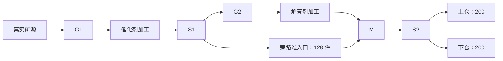

# Factory Engineering Scale V1

更新时间：2026-10-17

状态：D4-S0 **待审阅提案**，未批准实施。已核对现行代码并完成离线坐标 / 端口 / 电力几何核算；未启动 Godot、未新增工程世界身份或运行入口。普通世界、存档和验收预算保持现状。

## 用途与推荐决策

本篇细化 [D4 方案](../planning/factory-d3-exit-and-d4-validation.md)中的工程规模前置合同。推荐在现行 V5 生产、物流、电网与保存链路内增加一个严格隔离的工程身份，采用 20 个重复单元、100 台生产 / 仓储设备、1,000 段带。目标是证明这些真实系统在首档规模下仍可生产、诊断、保存与恢复；不新增玩家玩法，不将工程准备当作首程体验。检查级文档豁免开发闸门的新增玩家动作要求。

建议整组审阅以下决策，确认后才进入实现：

1. 保留 schema 5 字段结构，新增且只允许本篇定义的工程 ruleset / map / supply 三元组；普通 V5 身份、326 件供给及逐级升级保持。
2. 工程地图仍为 64×64，采用独立的全通行场坪与 20 个固定矿点，普通 / 富集各 10；没有普通地图矿壳屏障，但仍使用真实配方解锁与统计事实，不宣称覆盖勘探路径。
3. 首档 100 台改为 20 采集器、40 加工器、40 仓库；另加 40 电源、20 节点、40 分流器、20 汇合器、60 准入口。改变历史设备构成须明示；帧、单步及 30 分钟预算不降低。
4. 连续生产长测与高密度回压分开准备。前者要求 40 台加工器在每档都有真实完成与交付；后者允许停料 / 缺电的明确准备操作，证明拥塞运动与恢复，不拿它代替长测。

## 当前实现为何不能直接扩量

| 当前约束 | 代码事实 | 提案处理 |
| --- | --- | --- |
| 普通身份与入口 | `codec.gd` 按 supply 选版本；V5 decoder 固定 AdmissionModel；`store.gd` 与新建菜单限定普通身份 | 增加精确工程三元组分派；工程创建只由专用检查入口调用，普通菜单不增加选项 |
| 地图与矿种 | `discovery_rules.gd` 只有 6 个矿点；`discovery_model.gd`、`power_grid.gd` 直接调用普通 open_cell；模型 / codec / 视图用 x 坐标判断富集 | 将地图通行、矿点矿种及矿壳展示收敛到已验证的地图身份；放置、碰撞、接电、近身操作、保存和视觉读取同一规则 |
| 连接列表 | `codec_v2.gd` 上限 91，来自普通 14 个电力节点的完全图 | 工程 60 节点上限 1,770；仍逐边校验端点、距离、通行、唯一排序与自动重建一致性 |
| 电量统计 | `statistics_validator.gd` 写死 240 kW 装机和 1,440 kW 请求上限 | 普通保持原值；工程分别为 4,800 / 3,600 kW，按供给合同校验所有历史桶、当前桶及累计量 |
| 物流能力分派 | `routing_world` 与准入口 validator 等按普通 supply 判断 | 使用严格身份对应的能力判定；审计 HUD、资产加载、摘要、codec，不把任意 supply 当作 V5 |
| 历史规模夹具 | schema 1 的 25×4 设备、40 带单元，备用反应器不工作，且无 V5 电力 / 多配方 | 保留旧入口，不改旧档版本或套用成绩；新夹具单列构成与工作率 |

这些是批准后的影响面，不是已经完成的修改；不通过全局放大常量或复制一整套模拟器绕过约束。

## 身份、保存与隔离

| 字段 | 推荐工程值 |
| --- | --- |
| world_kind / save_schema_version | `factory_3d / 5` |
| ruleset_id | `factory_engineering_admission_v1` |
| map_id | `factory_engineering_yard_64_v1` |
| supply_id | `factory_engineering_load_100_v1` |

新值仅为提案。继续沿用 V5 实体、发现、统计、自动电网、配额及时间字段；不增加自定义容量、虚假物品来源或可注入地图的任意字典。固定地图数据由版本化 map_id 决定，不写入存档。之所以建议保留 schema 5，是状态结构与同类字段含义保持，差异可由现有三个版本化身份完整表达；若实施发现必须增加状态字段或改变既有语义，退回审阅，再决定新 schema，不能硬塞进 V5。

- decoder 先验证完整三元组，再构造对应模型；只支持“普通完整三元组”与“工程完整三元组”，交叉拼接、未知身份或未来版本均致命拒绝，不进入旧备份回退。旧客户端因未知 ruleset / map 拒绝工程档；须实际补拒绝与主档不变测试。同 schema 的普通 / 工程备份也不互相恢复，不能只用版本号选择候选。
- 普通 create / continue / 2→3→4→5 升级不领取工程构件，不转换为工程世界。工程档无返回普通世界的转换入口；旧 schema 1 工程档亦不迁移。
- 专用 runner 强制仓库内忽略提交的双根目录、新 batch、新 world_id；拒绝生产 `user://`、软链接、持锁、已用批次。来源、代码指纹、准备 / 样本哈希与失败日志保留。
- 正式 Boot、Store 的锁、三槽备份、严格读回及原子发布照常使用。默认 Store / 菜单拒绝创建与继续工程身份；隔离检查初始化时显式启用工程上下文，再允许同一正式 Boot 继续。这个开关只限制入口可见性，不弱化 codec 校验，也不是防恶意修改的安全边界。
- 工程标题 / 检查准备页明确标注“工程规模验证”；不新增普通菜单中的工程选项、不修改普通存档根。工程快照误放默认目录时显示不支持，不自动删除或转换。

## 构件与电力预算

| 构件 | 每单元 | 20 单元总数 | 长测职责 |
| --- | ---: | ---: | --- |
| collector | 1 | 20 | 10 普通 / 10 富集矿源，真实缓冲与回压 |
| reactor | 2 | 40 | 10 基础催化剂、10 富集催化剂、20 解壳剂；没有备用空机冒充工作量 |
| storage | 2 | 40 | 每仓仍 200 件，合计 8,000 件容量 |
| belt | 50 | 1,000 | 全部接入声明的有向路径；配额用尽后支路可真实回压 |
| power_source | 2 | 40 | 每源 120 kW，可关闭；总装机 4,800 kW |
| power_junction | 1 | 20 | 6 格设备覆盖 / 12 格节点连接保持 |
| splitter / merger | 2 / 1 | 40 / 20 | 催化剂分配、两产物汇合、双仓分配 |
| admission_gate | 3 | 60 | 原矿筛选、加工进料、催化剂旁路本轮配额 |
| **合计** | **64** | **1,280** | 100 台生产 / 仓储 + 1,000 带 + 180 电力 / 附件 |

配置工作负载的同时请求上界为 `20×20 + 10×40 + 10×80 + 20×60 = 2,800 kW`；工程存档按任意合法配方的更宽上界 `20×20 + 40×80 = 3,600 kW` 校验，不能用当前布局的 2,800 拒绝合法改配方历史。装机不等于实际用电，空闲 / 缺料设备仍不请求功率。

离线几何得到 60 个电力节点、198 条自动可连边、一个网络，60 台用电设备均在真实覆盖范围内。1,770 是校验防护上限，不伪造 1,770 条实际边。每个固定步继续运行正式电网记账与物流；只允许既有的拓扑修订缓存，不预置 powered、不无限供电。

## 固定地图与单元坐标

全图边界仍为 `[-32,32)`。单元原点 `O(c,r)=(-30+15c,-30+12r)`，`c=0..3`、`r=0..4`；占用均落在 `[-30,30)`。单元矿点为 `O+(0,3)`；`(c+r)%2=0` 普通晶体，否则富集晶体。只能在这 20 个固定点放采集器，矿种由表决定；不按 x 坐标推断。外围保留角色 / 相机边界，建议初始审图落脚点 `(-31,-31)`，正式碰撞与服务路线仍须实现时验证。

以下坐标相对 O，机器保持现有固定朝向，方向 E / S / W / N 对应 `0/1/2/3`：

| 名称 | 左上格 / 朝向 |
| --- | --- |
| 采集器 / 催化剂加工 / 解壳剂加工 | `(0,3)` / `(5,0)` / `(5,6)`，均 E |
| 上仓 / 下仓 | `(11,5)` / `(11,8)`，均 E |
| 电源 A / B / 配电节点 | `(0,6)` / `(0,9)` / `(6,4)` |
| 催化剂分流 S1 / 成品汇合 M / 双仓分流 S2 | `(8,2)` / `(8,9)` / `(9,9)`，均 E |
| 原矿 G1 / 加工进料 G2 / 旁路 G3 | `(4,2)` E / `(4,8)` E / `(8,10)` N |

路径相邻拐点间逐格展开并包含端点；最后一格若是准入口，计附件而非 belt。普通带朝下一格，末格明确朝下游端口：

| 路径 | 拐点 | 带 / 闸 |
| --- | --- | --- |
| 采集器→催化剂加工 | `(2,4)→(2,1)→(1,1)→(1,0)→(4,0)→(4,1)→(3,1)→(3,2)→(4,2)`，末格 E | 12 / 1 |
| S1→解壳剂加工 | `(8,3)→(8,5)→(3,5)→(3,8)→(4,8)`，末格 E | 11 / 1 |
| S1→旁路→M | `(9,2)→(14,2)→(14,11)→(8,11)→(8,10)`，末格 N | 21 / 1 |
| 解壳剂加工→M | `(8,8)`，S | 1 / 0 |
| S2→上仓 | `(9,8)→(9,6)→(10,6)`，末格 E | 4 / 0 |
| S2→下仓 | `(10,9)`，E | 1 / 0 |

G1 允许该单元矿种、不限量；G2 允许催化剂、不限量；G3 允许催化剂、本轮 128 件，均允许接收。S1 将催化剂送加工或旁路；G3 用尽后旁路逐渐填满，S1 自然选择仍可接收的加工支路。M 接收解壳剂与旁路催化剂，S2 公平送两个仓。不存在自动出仓、货物销毁或周期清仓。

离线核算覆盖 1,280 个实体、2,100 个互不重叠占用格和 1,220 条定向物流连接；每个分流器恰有两个已接输出，其余输出不误接邻格。结果只证明声明几何，尚不证明 Godot 运行、寻路、实际调度或出货。

## 准备、容量与工作负载

**来源**：新工程世界从零库存创建。先只布置一个普通矿单元，通过真实模型移动 / 拾样 / 加工 / 取放 / 开路命令完成唯一试制与 12 件消耗，保留合法统计与物料；再建满全部单元并配置。工程地图全通行不代表自动写入发现事实：passages 仍记录命令及耗材结果并参与解锁 / 统计校验，但不控制这张专用场坪的通行，属于工程 ruleset 的明确差异。这段仅是合法前置生成，不算自然勘探。样本位置与开路命令锚点沿当前规则，先完成前置再覆盖可能占用的场格；后续不重复拾样 / 开路。若该路径无法合法执行，修订准备布局，不伪造统计、外部取得普通物料或直接置 true。

前置剩余物料全部计入一个普通单元，限定不超过 80 件（含采集缓冲、输入 / 输出、在制投入、运输槽与仓 / 背包），并列出各类 / 等价值；不得含富集晶体，超出则合法消耗或重新生成，不丢弃。富集单元全量部署时必须零库存 / 零在制。全部形成后记录 `full_layout_start_tick`（证据清单字段，不写产品存档），真实模型显式推进 600 秒填完整历史；每个单元的完成、交付、G3 计数、各仓余量和电量分别记录。准备不计前台性能。

容量推导采用全量部署后最多 2,500 秒：600 秒准备 + 1,800 秒采样 + 最多 100 秒预热 / 阶段间生产。富集加工至多 `floor(2500/12)×3=624` 件催化剂；旁路最多 128，故累计终端入仓上界 `624/2+128/2=376` 件。双仓公平分配、无其他写入时每仓至多 188，仍留 12 格。普通单元按 250 催化剂算，终端上界 189；前置最多 80 件即使全计入同一仓，保守每仓上界 `ceil(189/2)+80=175`。普通配方不会把这批剩余物料扩成更多件；初始半批的额外产物也归该余量预算。须实测证明 S2 分配差不超过 1，不能只凭总容量宣布无满仓。

该推导是保守计数预算，不是吞吐实测。恢复与短探针在独立副本运行，不消费长测父档。任何富集单元初始夹带物料、超时、单仓分配异常或 450 秒内加工 / 收货停止，都使准备或该档失败；不能临时清仓、降低产率或缩短档位来保通过。

| 工况 | 生成与目的 | 必须记录 / 通过条件 |
| --- | --- | --- |
| W：持续生产 | 上述同一准备父档，四档连续各 450 秒；不在档间复位世界 | 每档 40 台加工器与 40 座仓都有完成 / 入仓；任意完整 120 秒内各加工器至少完成一次、各仓至少入仓一次，排除只在开头出一件；无满仓、缺电或计时积压；矿源按真实需要工作，不能称全部满速 |
| C：竞争与配额 | W 的准备与前段、另用新副本做双方待送验证 | 每个 S1 两支路与 M 两输入均有实际成功转移；真实共同争用与公平结果单列，不能仅凭接线推断。G3 的 127+持 1、用尽、停收排空与重置跨进程保持 |
| B：高密度回压 | 单独副本，合法改变 G3、填仓并真实推进生成拥塞；不计 W | 保持 100 台 / 1,000 带；记录普通带与附件占用分解，目标总在途 900–1,000。若需停料 / 关电稳定密度，必须记录，至少见货物实际转移与堵塞修复；不称持续加工性能 |
| R：拆改 / 电网 | W 独立副本，三次带段拆回重建、仅保留 1 个启用电源后再复源、节点调整 | 不丢货、错误对象不串线；在真实请求超过 120 kW 时见比例供能与缺口、复源恢复；保存重进继续，窗口原图及操作路径分列 |

物理运输槽位为 1,120（1,000 带 + 120 附件），原“最多 1,000 在途”的验证锚点仍按**全部运输设施内货物总数**计，不能把附件隐去。B 准备必须证明如何在不冻结货物、不删除物料的条件下留在 900–1,000：优先从原矿支路已满的真实拥塞副本停止 G1 新接收，记录并限制尚可转入运输槽的机器缓冲 / 在制量，再采集 30 秒自然物流与修复段；必要时有限关源，明确记作停料 / 缺电回压对照。若无法满足密度范围与运动证据则保持缺口。超过 1,000 的满槽压力可另提，不自动扩成本轮验收或换口径。此项是实施前置中需实际求证的风险，离线几何不作通过证据。

## 实施分包与退出证据

| 步骤 | 修改职责 | 退出条件 |
| --- | --- | --- |
| S0-A 身份与地图 | 固定工程数据、模型身份 / 能力与地图查询、codec / 统计上限、Store 显式工程上下文 | 普通 V1–V5 与旧二维规则保持；完整三元组严格接受、错配 / 未知 / 越额拒绝；自动电网重建、守恒、备份失败不写坏源档 |
| S0-B 布局与准备 | 专用布局 / 状态检查、合法前置生成、600 秒历史、Shell / PowerShell 共享 runner | 正式模型复核全部足印、端口、198 条预期边及服务路线；20 单元产出 / 电量 / 容量证明；B 密度方法实际成立 |
| S0-C 独立恢复与短窗 | 新副本写 / 读、半批半程与配额、失焦 / 关闭中断、正式 Boot 原图 | 完整首帧 / 同步数终点一致；新批次、来源不变、每段中断阻止后续；短窗 4 个尺寸 / 视距组合按原画质初筛 |
| S1 持续验收 | 复用已经审阅的正式采样器，明确工程来源与负载记录 | 四档各 450 秒、合计 1,800 秒前台；帧 p95 ≤16.7ms、模拟步 p95 ≤10ms、最大余量 <0.5 秒、时钟误差 ≤1e-5 秒、每次自动保存成功，且 W 工作负载判据通过 |

建议新增 `factory_engineering_*` 数据 / 检查模块及专用入口，名称在实现时定；不预写不存在的可运行命令。共享 `discovery_model`、`power_grid`、codec / statistics validator、view / HUD / Store 只做身份与地图边界需要的修改；不改配方耗时、带速、仓容、普通供给、渲染介质或调度公平性。修改共享能力判断后须定向覆盖普通 V5、旧版本及 A/B/C 关键路径，检查范围依据实际 diff 决定，不用整套历史窗口重跑替代风险分析。

存档拒绝矩阵至少包含：三个身份任一错配、普通世界伪装工程高库存、非法矿点 / 矿种、地图边界与人物碰撞、未知附件、构件不守恒、货物 / 配方 / 批次 / 配额非法、超限电量与图边、自动接入不一致、未来版本主档带旧备份、锁冲突和发布故障。所有拒绝均须证明无修复性清货、无序号偷增、无原主档覆盖。

S1 沿用窗口 / 最大化 × 局部 / 拉远四档，不缩分辨率或降画质；实际窗口、3D 与 PNG 像素单列，保留原始帧 / 步与自动保存尖峰，用户准备页手动开始，失焦 / 关闭停止全序列，不抢焦点或自动重开。统计叠层的规模性能若需验收，另作同状态短对照，不包含在四档默认结论。

## 风险、未决与审阅边界

- 实际规模可能暴露电网逐设备分配、物流候选和统计 UI 的热点；失败先记录瓶颈，不在本提案预授权算法重写或性能降级。
- 细密布局的近身服务与图标可读性只做了几何设计，必须补正式模型碰撞与窗口审阅；合法放置不等于可手动维护。
- W 后期旁路配额用尽会改变有效物流分布，逐档报告活跃 / 缺料 / 回压 / 在途数量，不能把 1,000 带称为同时满载运动。C 与 B 分别承担竞争和密度证据。
- B 的自然密度窗口、全部加工器每档完成以及固定前置合法性尚未运行验证；不把待审阅方案记作 S0 通过。若失败需要改设备构成、地图、容量或验收口径，先更新提案再确认。
- 用户亲测、D3 退出裁决、Windows / 目标硬件与玩法冻结项仍按原计划。批准本篇只覆盖 S0 实现与定向验证；S1 长窗口另按用户可用前台时段告知安排，不推送 / 打包 / 发布。

本轮证据：`tools/runtime-intake/check-runs/factory-engineering-scale-design-v1/contract-20261017-b/` 保留离线审计、脚本与布局清单。它使用提案中的全通行地图，不调用产品代码，不能替代 S0-A/B。首轮 a 暴露原矿路线从侧面接入单入口闸，已修正方向并保留失败记录；周志记录实际检查与批准状态。
