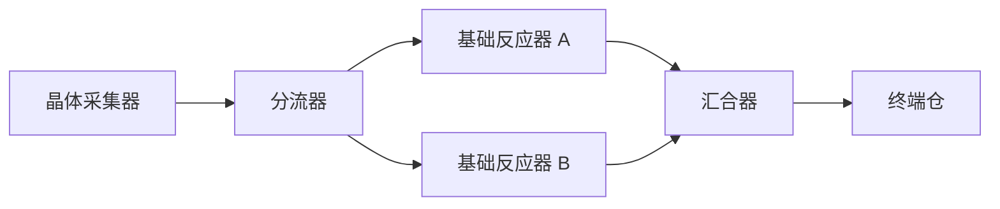

# Factory Conveyor Routing V1

更新时间：2026-10-08

## 状态与用途

本专题承接[附件日程](../planning/factory-conveyor-accessories-roadmap.md) A 批：分流器与汇合器的共同调度设计。萝卜SAMA在下一步建议后明确要求“开始吧，继续推进”，本次先完成设计，随后萝卜SAMA明确“确认，继续推进”，新增供给、schema 4 与物流时序已获实施确认；模型、保存升级、资产与操作已接入，定向工程验证与短窗口原图复核通过。此前新面板、首程亲测和 D4 待验项保留，不把继续设计记作体验验收通过。

本篇回答玩家路径、端口、调度、版本影响和验收；旧 schema 3 合同仍以[保存 V3](../architecture/factory-discovery-save-v3.md)为准。schema 4 的正式增量合同见[保存 V4](../architecture/factory-routing-save-v4.md)，既有版本合同保持。

## 已确认的实施边界

已确认采用：1×1 被动单件附件、普通供给各 8 件、保留普通带侧入、schema 4 统一公平仲裁、旧 schema 3 显式备份升级。主要代价是原机器末尾补带改为统一快照，可能多等 50ms；收益是所有来源共享可解释的仲裁与严格恢复次序。这组运行 / 存档变化已确认，后续在该范围内连续实施和验证，不重复申请授权。

## 玩家结果与边界

- 玩家从物流建造栏放置分流器，把一条晶体带分给两台基础反应器，再用汇合器把两路催化剂送入同一终端仓。可在现有地图与普通供给内完成，接好后 5–10 分钟内看到各支路生产与仓库增长。
- 分流减少重复供料线；汇合提供一眼可辨的多入口设施。当前普通带已支持侧向合流，不能把汇合器宣称为首次支持合流；旧带的侧入能力保留，不强制玩家拆换旧布局。
- 产线组织服务催化剂与后续开路材料供给，不增加探索门槛或新的解锁货币。初始提供 `splitter=8`、`merger=8`；原采集器 8、反应器 16、仓 8、带 256、电源 2、节点 12 保持，总实体预算由 302 变为 318。
- 两类附件被动工作，不接电、不耗电；单格、单件缓冲，不能代替仓库。背包 / 仓容量 200、既有配方、6 / 12 格供电、样本手动拾取、后台生产与退出后不补产均不变。
- 本批不做过滤、优先级、比例设置、配额 / 限速、物流桥、地下带、液气、仓库出料口、蓝图、工程供给或多人。物品准入口留给 B；A 不以未实现的过滤器作为正确运转前提。

这是物流关系示意，实际连接仍须逐格铺带；不是跨空间直连或已验证布局。

## 实现介质与失败退出

主画面用两个自有 GLB、导入场景和现有货物模型；沿既有圆润机械 / 化工家族。分流器为单入口向三出口展开的壳体，汇合器为三入口收拢到单出口的壳体；端口方向同时由几何和小箭头表达，不靠颜色独自区分，不增加悬浮端口文字墙。制作沿[工厂资产工具](../../tools/factory-content/README.md)，仅使用已有本地依赖；缺失依赖或需要外部素材时另行说明并授权。

附件中央为遮挡内部换向的机械壳体；可见货物只显示已确定的入口运动与实际发出的出口运动，不在不同出口间跳动。模拟只向相邻格交接；资产不得用跨格管线掩盖错误连接。程序绘制只承担选中、状态及调试，不能成为设备主体。

成功证据须同时含状态 / 独立恢复断言、普通供给自然产线、少量正式 Boot 原图及用户理解反馈。若端口在现有 50° 视角无法辨认，先改壳体与接口组织；若两次同类窗口审阅失败，停手复盘，不追加文字 / 光圈补丁。若共同调度不能满足守恒或重放一致性，停止接 UI，不以每种附件特判兜底。

## 端口、相邻连接与命令

`dir=0/1/2/3` 沿现有东 / 南 / 西 / 北顺序；以下均为相对设备朝向的逻辑端口，旋转后整体变换。端口号不随世界坐标变化。

| 设备 | 足印 | 输入 | 输出 | 轮转顺序 |
| --- | --- | --- | --- | --- |
| 分流器 `splitter` | 1×1 | 后方唯一入口 | 前、左、右 | 输出 0=前、1=左、2=右 |
| 汇合器 `merger` | 1×1 | 后、左、右 | 前方唯一出口 | 输入 0=后、1=左、2=右 |
| 普通带 | 原 1×1 | 保留后方与侧方合法输入 | 既有 dir | 保留以来源实体 ID 轮询 |

- 一个端口只与相邻格、方向相向的端口连接。支持带 ↔ 附件、附件 ↔ 附件，以及已有采集器 / 反应器出料口 → 附件、附件 → 反应器 / 仓入口；机器仍固定原足印与端口，不借此解冻机器旋转。
- 连接判定共同检查端口位置、方向、物品许可及目标容量。输出对输出、输入对输入、隔格或斜接不产生边。设计要求预览显示不匹配原因，并允许先放孤立构件再接线；“未连接”不等于放置失败。当前实现的预览仅显示端口箭头及落位合法性，具体连接原因由放置后的设备面板呈现；预览原因尚未接入，日终审阅登记为待补，不以已有窗口通过代替此项。
- 放置检查地图、矿壳、占用、构件数和人物位置，失败零变更。附件为不可穿过的实体，不能放在人物脚下；带仍沿现有可通行规则。拖铺止于附件占用格，不自动替换 / 吞掉它。
- 建造中 R 转向；放置后的附件只有空载时可转向。带货旋转拒绝，提示等待排空或回收；成功旋转将本机轮转游标归零，刷新相邻连接，不改变其他设备次序。
- 回收整件返回构件及内部物料，背包不足则整体拒绝；无地面掉落或静默丢弃。拆回不退电、不增加产消。空载 / 回收均不能远程取走内部货物；A 面板不新增手动塞货口。

## 共同物流调度

### 每步阶段与货物速度

沿用 20Hz 固定步、每带单件、带内行程 1 秒。schema 4 将普通带、附件和机器出料纳入同一份“请求 → 仲裁 → 提交”，避免机器出料和带货对同一入口使用不同优先级。

1. 既有供电与生产阶段先执行；本步刚完成的输出可提出物流请求，进度与物料事件仍由生产模型负责。
2. 在物流开始时冻结占用 / 容量快照。已有带货、附件货物进度加 `0.05` 并封顶 `1`；新接收货物进度为 `0`，必须经过后续 20 步才能再次交接。
3. 所有已到出口的货物和机器输出生成合法请求；目标只接受快照中已有的空位。本步开始有货、稍后离开的槽也不能立刻补入，不递归推进空位，不进行满环同步交换。
4. 按下文分轮仲裁；每个源最多发出一件，每个运输槽最多接收一件。机器输入按物品缺口 / 仓剩余容量预约，不能超额。
5. 验证整组转移后一起提交，货物与 batch 从源移到目标；只有成功交接才更新有关游标，物料产消保持不变。入仓只按现有 delivery 事件记账，不把经过附件记成产量。

这是明确的 schema 4 时序变化：旧版 `_logistics()` 先处理带，再在末尾允许机器填入刚腾空的带，并未将机器出料纳入同次公平仲裁。统一快照后，原带的端口和 1 秒行程保持，但源头补入可能多等 1 步（50ms），竞争次序可能变化；不能宣称升级前后整条轨迹完全相同。

附件总出口不乘以支路数：单件至少驻留 20 步；持续满供且出口可接收时，相邻两次收货至少间隔 21 步，单槽稳态上限为 `20/21 ≈ 0.952 件/秒`，三路合流合计也受同一单槽上限约束。UI 用“单件行程 1 秒 / 容量 1”说明，不能误标每路 1 件/秒或宣称提高产量。该设计推导已由定向饱和路径验证：第 0 / 21 / 42 / 63 / 84 步连续收货。

### 分流、竞争与公平性

- 分流器从 `output_cursor` 指向的相对出口开始扫描三个出口，跳过未连接、方向不匹配、目标满载或不收当前物品的出口；没有候选时留货等待，不清空、不旋转游标。
- 第一轮每个未发送源只请求其当前首选目标；各目标独立选一个来源。汇合器按 `input_cursor` 循环扫描相对入口；普通带按已保存的来源 ID 游标循环；分流器自身只有一个输入，机器入口也只有一个物理相邻来源。
- 本轮获准的源 / 目标锁定，不再参与后续轮；输掉竞争的分流器可从尚未尝试的出口重试，最多三轮。普通源只有一个出口。所有请求由相同快照生成，轮间不能借新产生的空位抢跑；算法结果不得依赖实体数组 / Dictionary 枚举顺序。
- 分流成功后将输出游标设为成功端口的下一个；汇合成功收货后将输入游标设为获准端口的下一个。普通带成功收货后保存获准来源 ID；来源之后拆除时，保留该 ID 作为排序边界，不要求它仍有实体引用。
- 单个分流器的三个出口持续有效、无额外竞争时，每三次成功派发各得一件；封一个出口后其余两路轮流。单个汇合器的三个入口持续有成熟货物时，每三次成功收货各获准一次。出口堵住期间不算公平机会，恢复后从保存的游标接着服务。
- 公平保证是局部有效请求之间的轮转，不是全地图任意时刻的产量相等。持续断料、间歇可用、下游长期堵塞会改变各路份额；不补历史欠额。复杂共享目标须验证竞争与重试不会导致持续请求饥饿；若不能证明 / 复现通过，退回调度设计，不能缩减断言冒充保证。
- 全满闭环保持堵塞，人工拆回一件产生空位后才可能继续；此为单槽回压边界，不新增无容量交换。空位、端口索引与仲裁工作集均为派生状态，不保存。

设计手算示例（非运行验证）：分流起点为前，三个出口有效时，前三次成功依次为前、左、右，起点回到前；此时封左，后两次为前、右；再封前 / 右，货物停留且起点保持前；解除左，下一次送左，起点变右。单槽在第 0 步收货、第 20 步发出，第 21 步才能再次收货、第 41 步再次发出，给出上述 21 步间隔。恢复必须保留这个起点和半程位置，不从前口重新均分。

### 混料与堵塞反馈

普通可上带物品为晶体、催化剂、解壳剂、富集晶体；矿壳样本继续禁止自动物流。附件不加工、不转化、不自动按配方分类。

混料遵循各入口到达次序和仲裁结果。分流只检查紧邻目标：紧邻反应器不收某物时可跳过该出口；紧邻空带会收货，即使更远处最终是错误配方，也不全线寻路、提前过滤或自动退货。一件错误物料可回压整条支路，提示定位直接阻塞处；B 准入口另行解决物品筛选。

设备摘要显示当前物品 / 数量、容量、行程、三个端口状态和轮转起点。优先反馈“等待来料”“运输中”“全部出口未连接”“出口方向不匹配”“目标已满”“目标不收该物品”或“本步等待其他来料先行”；多原因按端口展示，不能只写笼统“没有工作”。失败原因来自调度判定，UI 不另造一套连通规则。

## HUD、统计与首程接入

建造栏增加两个独立图标、剩余构件数及预览；保持 F / Tab 近身打开、I 背包、Esc 返回和面板内持续生产。附件摘要复用图标格 / 模型预览，轮转起点用“下一次先尝试前 / 左 / 右”等短文案，不暴露内部 ID 算法。

库存查询把附件内货物计入“在途”，纳入全局持有量和 batch 约束；产消曲线不因分流 / 合流出现重复事件。设备定位支持附件，电力页不将被动附件统计为消费者。不新增路由历史日志、统计桶字段或逐端口曲线。

首条催化剂入仓仍可只用普通带完成，现有必做引导不加附件步骤。产线扩展提示可在首件催化剂入仓后介绍分流 / 汇合，状态由实际布局和物料派生，不新增教程存档，也不挡住样本、试制与开路。

## 保存、兼容与升级

- 新世界使用 `factory_3d / 4 / factory_discovery_routing_v1 / factory_discovery_yard_64_v1 / factory_discovery_routing_starter_v1`；地图与自动供电不变，规则 / 供给独立标识，预算 318。
- 普通带保留 `cargo/progress/entry/cursor/batch`。附件保存共用 `id/type/x/z/dir/cargo/progress/entry/batch`，分流器另有 `output_cursor`，汇合器另有 `input_cursor`；游标均为相对端口编号 0–2。不保存目标 ID、预留请求或计算图。
- `entry` 是最近收货的世界方向基向量；持货时必须为该设备有效输入方向。空附件规范为 `cargo=""、progress=0、batch=0、entry=后方`；清空不重置公平游标。持货 `progress` 有限且在 [0,1]，数量固定一件。游标须为整数，非法值拒绝，不取模修复。
- 原矿 batch=0；催化剂 / 制剂 batch 合法且与现有跨输出、带及附件的同批总件数约束一致。拆回进入背包后沿现有数量守恒，不新增无限批次日志。样本上附件、未知物品 / 类型、供给混配、重复 ID、空间重叠、超预算一律拒绝。
- schema 1 / 2 / 3 原读写和物流规则保留；未升级旧世界仍可继续。schema 3 从世界菜单明确选择升级，说明新增构件与新仲裁时序、保留原档；schema 2 先沿现有流程升级到 3，再单独选择 4，不合并两个确认事务。schema 1 与旧二维 10 不迁移。
- 升级必须持有锁，严格解码来源并核对主档哈希；实体、货物 / batch、带进度 / 游标、背包、发现、电网、统计、时间、世界 ID 与名称原样保留，只增加两个附件 kits、更新身份和 sequence。无附件时也按 schema 4 时序继续，不能继续标称旧规则。
- 源原文保存到独立 `backups/pre-routing-v3-<sequence>-<hash>.json` 并读回核验；沿临时文件、严格读回、哈希与原子发布。渲染重建和保存失败保留旧主档 / 来源，释放本会话锁；升级不做后台批量改档、不读写用户正式目录做测试。
- 见到 schema 4 主档后禁止自动回退为 3 / 2 覆盖；未来 schema / 未知规则继续阻断所有备份回退。恢复候选只沿当前世界版本边界选取，升级副本不进入日常三槽轮换。旧客户端遇 4 明确拒绝。
- 独立恢复要求同一 schema 4 快照、相同后续命令与步数下，逐步物品、进度、批次、轮转及统计一致。升级前后不要求相同物流轨迹，升级瞬间要求全部财产和历史守恒。

## 实施边界与顺序

1. **权威模型与版本**：新增具体物流端口 / 调度模块，供放置预览、模拟与状态反馈共用；以 ruleset / 模型边界选择旧或新调度，不把 schema 判断散布进每条搬运分支。扩展 catalog / supply、物品持有量、批次 / 守恒检查及独立 codec；保留原固定步与活动时钟。
2. **资产与正式操作**：导出 / 导入两个 GLB，接建造、旋转 / 回收、货物视图、F / Tab、面板、库存与定位；不使用占位方块交付正式玩法。
3. **普通线与独立恢复**：自然路径验证分流两条基础催化剂线再汇合入仓；中途人为堵一路并恢复，另测混料拒收；半行程 / 轮转后保存并独立启动继续。

主要影响点为 `client/data/factory/discovery_rules.gd`、`model.gd` / `discovery_model.gd` 的物流边界、`items.gd`、`save/codec*.gd` / `store.gd`、`view.gd` / 端口叠层、设备面板、统计查询和世界菜单。实现前细化模块职责；不复制整份 discovery_model 或 codec_v2 来形成长期双份实现，也不为保留旧规则做大规模无关重构。

## 可执行验收计划

| 层级 | 必须证明 | 输入与证据边界 |
| --- | --- | --- |
| 定向状态 | 四方向端口；相邻附件 / 机器；孤立 / 错接；三路均分、堵一 / 堵全及恢复；合流不饿死；多源争同一空槽与分流重试；实体数组打乱后结果一致 | 精确 20Hz 步数，显式标记构造夹具；至少两个构建顺序；不当作自然建线 |
| 守恒与命令 | 混料 / 样本拒绝；回收满包零变更；带货旋转拒绝；一件只跨一条边；多件同 batch 跨设备；在途统计无重复；全满环及释放 | 每步核对全物品与批次，不只比较最终总数 |
| 时间与恢复 | 30 / 60 / 144 FPS 分帧输入达到同一固定步状态；饱和单槽吞吐；半进度、堵塞、两个游标各边界独立进程恢复 | 模型分帧不等于渲染性能；后台时间不记前台性能 |
| 版本与文件 | 新 4 严格解码；旧 1 / 2 / 3 回归；3→4 升级 / 取消 / 锁冲突 / 哈希变化 / 备份失败 / 发布失败；未来版本阻断回退 | 仓库忽略的双根隔离与独立原档，真实失败注入单列 |
| 正式后台 Boot | 新普通供给、自然产线、真实 F / Tab / 建造输入、堵塞修复、保存返回及独立 read | 优先沿既有无窗口功能驱动，不抢前台、不注入物料 / 生产时间；截图明确省略 |
| 原图与体验 | 50° 默认视角与最小窗口识别两种附件 / 旋转；箭头不遮挡；玩家能说明哪路堵、怎样修复 | 少量事先告知的窗口任务；人工反馈单列，无窗口不冒充视觉通过 |

普通产线预算示例：1 采集器、2 基础反应器、1 仓、1 分流器、1 汇合器、1 电源及按距离布置的节点；总负荷 100kW，可由一套 120kW 供给。支路先运同一种晶体，两台输出均为催化剂，混料不是这条成功路径的隐藏前提。实施时先验证布局、路径可达与带数，再固定自然路径夹具；不能直接注入目标产量。

当前状态检查 488 项、独立进程恢复 3 项、正式菜单 9 项通过；后台自然写入 119 项、独立 Boot 恢复 28 项、短窗口 48 项通过，分流 / 汇合面板、旋转预览及全线原图已审阅。同批三件跨带与附件的独立夹具 5 项通过；它使用显式物料位置调整，不计自然建线。运行批次与失败记录见 W41，未记用户体验通过。A 退出不以 B 准入口已完成为条件；全附件 C 组合验收仍由路线图承接。

## 亲测入口

在仓库根执行 `sh tools/runtime-intake/review-worlds/factory-conveyor-routing-v1/playtest-20261008/start.sh`。正式 Boot → 工厂世界 → 继续已有的分流汇合世界；当前暂停，人物位于汇合器旁，点击继续后观察两台反应器合流入库。F 查看附近设备、Tab 切换、I 背包、B 建造、R 旋转预览；也可选择勘探工厂新建零库存世界。

本地副本来自最终窗口 review 保存返回后的五份 JSON，SHA-256 与来源记录在同目录 `origin.json`；双隔离根不改用户正式世界或自动证据。附件识别、端口原因理解与独立搭线仍等待萝卜SAMA亲测；Windows、全链开路在 schema 4 下的完整窗口重跑及性能不在本次通过声明内。
