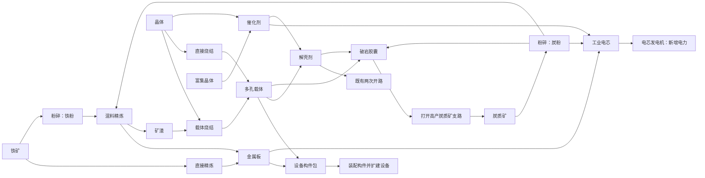

# Factory Production Expansion V1

更新时间：2026-10-17

状态：萝卜SAMA已确认切换到内容扩展主线，并要求先形成物品、设备与配方关系方案。本文为首版设计提案；阶段切换已生效，以下新增内容、数值和存档建议尚未实现。旧 D4 待验项保留，不作为本包设计或开发的前置门槛。

## 玩家目标与范围

玩家从“搭一条晶体加工线”进入“经营数条相互依赖的产线”：先制造扩建设备所需的构件，再分配材料生产电芯增加供电，最后制造开拓用品打开高产矿区，让新资源反过来改善工厂。

本包建议合计 **15 种物品（含原有样本）、14 个加工配方（含原有 4 个）、新增 3 类加工设备和 1 类能源设备**。它们属于同一张固定小地图的生产循环；首个可玩批次就交付“生产材料 → 获得构件 → 扩建设备”，后续批次接能源和开拓，不先做一大批没有用途的物品。

参考提炼见[终末地产线研究](../reference/endfield-production-planning-study.md)与[六款生产游戏对照](../reference/factory-game-production-study.md)。本轮补入官方资料、Wiki 与跨游戏取舍；下表全部新增数值是本项目设计，不是参考游戏数据。

## 完整生产关系

图中解壳剂的载体输入仅用于新增高效配方，原来的双催化剂配方与样本试制保留。主链没有启动循环：铁矿、普通炭质矿和晶体从初始区域可取得，封装电源及第一套加工设备预配；高产炭质矿是改善供给的回报，不是制造首批开拓用品的唯一来源。

## 物品清单与用途

| 物品 / 建议 ID | 来源 | 直接用途 |
| --- | --- | --- |
| 晶体 `crystal`（现有） | 初始矿点 | 催化剂、两种载体工艺 |
| 富集晶体 `rich_crystal`（现有） | 原矿道之后 | 高效催化剂生产 |
| 矿壳样本 `crust_sample`（现有） | 原手动拾取点 | 一次试制；不进入自动物流 |
| 催化剂 `catalyst`（现有） | 普通 / 富集反应 | 解壳剂、电芯；两条用途争用产能 |
| 解壳剂 `crust_solvent`（现有） | 试制、原量产或载体工艺 | 原两次开路、破岩胶囊；沿现有可运输物品单位，不在本包引入液体管网 |
| 铁矿 `iron_ore` | 初始固定新矿点 | 直接金属板或先粉碎再高效精炼 |
| 炭质矿 `carbon_ore` | 初始普通矿点 / 后续高产矿点 | 炭粉 |
| 铁粉 `iron_powder` | 粉碎机 | 高效金属板工艺 |
| 炭粉 `carbon_powder` | 粉碎机 | 高效精炼、电芯、破岩胶囊，共用原料支线 |
| 金属板 `metal_plate` | 精炼炉 | 设备构件包、电芯 |
| 矿渣 `mineral_slag` | 高效精炼副产物 | 廉价载体；必须输出或停产，不能自动消失 |
| 多孔载体 `porous_carrier` | 晶体直接烧结或矿渣回用 | 构件包、载体解壳剂、破岩胶囊 |
| 设备构件包 `construction_pack` | 组装机 | 在建造菜单装配为构件库存，再实际放置设备 |
| 工业电芯 `industrial_cell` | 组装机 | 在电芯发电机内消耗以供电，不是只供收藏的终端物品 |
| 破岩胶囊 `boring_capsule` | 组装机 | 消耗于新固定支路障碍，取得高产炭质矿；不引入战斗 / 武器系统 |

## 设备职责

足印、接口和功率为首版布局建议；正式端口坐标随实现布局冻结。电力仍采用节点 12 格 / 设备 6 格与真实同网供能。

| 设备 | 建议足印 / 端口 | 工艺职责与差异 |
| --- | --- | --- |
| 采集器（现有扩展） | 沿既有足印 / 输出 | 按所在矿点采晶体、铁矿或炭质矿；晶体 / 铁矿 1 件/秒；普通炭质矿 1 件/20秒，高产炭质矿 1 件/5秒，均为 20 kW 采集需求 |
| 基础反应器（现有扩展） | 沿既有接口 | 保留四配方，增加载体解壳剂；本包的化工中心 |
| 粉碎机 `crusher` | 2×2；一入一出；20 kW | 矿料转粉体；同一台可换两种配方，扩建可免去切换 |
| 精炼炉 `refinery` | 2×3；两入、主 / 副各一出；60 kW | 直接金属板、混料精炼、载体烧结；多产物让副产物流向成为布局问题 |
| 组装机 `assembler` | 3×2；三入一出；40 kW | 两至三种材料组装成构件包、电芯和开拓用品；每个输入口都可接当前配方需要的物料 |
| 电芯发电机 `cell_generator` | 2×2；一入、无物料输出；无需外部启动电力 | 吃工业电芯，上限 120 kW；补足封装电源之后的同网缺口，形成生产反哺能源的用途 |

新加工设备只接当前配方需要的物品；输入暂按每种原料两批容量、输出暂按一批容量设计，避免某一种来料占满所有输入。开始加工时原子扣齐输入并记录在制；主、副产物可完整容纳时一起完成。精炼炉主口输出金属板或载体，副口固定输出矿渣；任何所需输出未清空都会回压，不吞副产物。仓库仍为终端仓，不在本包扩自动出仓。

## 配方表

数量均为物品单位，功率为运行需求；缺电按现有供能比例减速。时间是调参起点，不是首次体验时长承诺。原四配方原数值保留。

| 编号 / 工艺 | 设备 | 每批输入 → 输出 | 秒 / kW |
| --- | --- | --- | --- |
| R01 基础催化剂（现有） | 反应器 | 晶体 2 → 催化剂 1 | 10 / 40 |
| R02 矿壳试制（现有） | 反应器 | 矿壳样本 1 + 催化剂 2 → 解壳剂 1 | 10 / 40 |
| R03 解壳剂（现有） | 反应器 | 催化剂 2 → 解壳剂 1 | 8 / 60 |
| R04 富集催化剂（现有） | 反应器 | 富集晶体 1 → 催化剂 3 | 12 / 80 |
| R05 直接精炼 | 精炼炉 | 铁矿 2 → 金属板 1 | 8 / 60 |
| R06 铁矿粉碎 | 粉碎机 | 铁矿 2 → 铁粉 3 | 6 / 20 |
| R07 炭矿粉碎 | 粉碎机 | 炭质矿 1 → 炭粉 2 | 6 / 20 |
| R08 混料精炼 | 精炼炉 | 铁粉 3 + 炭粉 1 → 金属板 2 + 矿渣 1 | 10 / 60 |
| R09 矿渣烧结 | 精炼炉 | 矿渣 2 + 晶体 1 → 多孔载体 2 | 8 / 60 |
| R10 直接烧结 | 精炼炉 | 晶体 3 → 多孔载体 1 | 8 / 60 |
| R11 构件组装 | 组装机 | 金属板 2 + 多孔载体 1 → 设备构件包 1 | 10 / 40 |
| R12 电芯组装 | 组装机 | 金属板 1 + 炭粉 2 + 催化剂 1 → 工业电芯 1 | 12 / 40 |
| R13 开拓用品组装 | 组装机 | 多孔载体 1 + 炭粉 2 + 解壳剂 1 → 破岩胶囊 1 | 12 / 40 |
| R14 载体解壳剂 | 反应器 | 催化剂 1 + 多孔载体 1 → 解壳剂 1 | 8 / 60 |

直接工艺无需炭线、粉碎和矿渣处理即可启动；混料工艺提供资源效率，但多占设备、端口与布局。R14 让载体在扩建和开拓间出现竞争，不强制替代 R03。R01–R04 沿原发现条件；E1 新材料配方开局可见，但首次目标先指向直接工艺扩建第二台炉，再提示混料回用；R12 随能源批次开放，R13 / R14 在原矿壳试制完成后开放，不另建研发点数树。

| 选择情境 | 建议工艺与真实取舍 |
| --- | --- |
| 刚起步、炭短缺、只需板材 | R05 直炼；多耗铁矿，换取不依赖炭与副产物出口 |
| 扩建需要板材与载体，炭线有余量 | R08 + R09；节材并降低当前配方的加工能耗，但增加设备 / 布线和炭竞争，不虚称它更耗电 |
| 没有矿渣、载体需求超过副产量 | R10 直接烧结补缺；不为了载体强产多余板材 |
| 解壳剂需要持续供料 | 在 R03 / R14 间看催化剂与载体余量；不能只比较反应器单步输入 |

**副产物不是任意需求下都能闭环。** 两包构件恰好消化四板副产的两矿渣；电芯只需板而不需载体，若电芯供板全走混料，矿渣即使烧成载体也会积压。本包保留直接供板线作为持续能源支线的选择，扩建停止后可减少混料。有限仓储只提供缓冲；不增加自动消失、万能换币或无限仓。设备应明确显示副口堵塞，配方用途页提示下游需求，玩家可以有意停线。

## 成品消费与回报

### 设备构件包：玩家自己制造扩建能力

只消耗背包里的构件包，建造菜单选择装配目标，成功增加相应构件库存；不从远处仓库无条件扣物。不再额外新增工作台设备。建议换算：

| 消耗 | 获得 |
| --- | --- |
| 构件包 1 | 传送带 8 段，或分流器 / 汇合器 / 准入口 / 配电节点任一种 1 件 |
| 构件包 2 | 采集器 / 反应器 / 终端仓 / 粉碎机 / 精炼炉 / 组装机任一种 1 件 |
| 构件包 3 | 电芯发电机 1 件 |

这是构件装配，不是材料的可逆兑换：回收设备返回原构件和内部物料，不返构件包；构件包不能兑换更多永久封装电源。菜单显示配方、可装配数量、背包缺口与世界预算，失败不扣物。构件需求随扩建发生，受空间 / 实体预算限制，不宣称是无限消费。首包保留通用包；设备专属材料成本属于后续候选，未修改本表。

### 工业电芯：让产线支撑更多产线

每件建议提供 7,200 kJ，可支持 120 kW 满负荷 60 秒；只按实际送入网络的能量扣除，无需外部电力启动。封装电源优先，电芯发电补同网缺口，多台同网发电机平分缺口并受各自 120 kW 上限约束，孤网不互抵。

单机原料缓冲最多 5 件，另有一件已激活电芯的剩余能量；不足时逐步激活下一件，停机保留余量。已激活电芯不可变回整件；回收先提示余能会损失并须确认，未激活电芯完整退回，背包不足则整次回收失败。保存必须保留余能，不允许拆装或重进刷新电量。暂不实现充电、空壳、蓄电网或电芯品质。

两套预配封装电源共 240 kW 始终保留，断燃料时玩家能关掉扩建负载恢复电芯线，不因发电机缺料而永久无法自救。

### 破岩胶囊：开拓回报进入原料链

原外 / 内矿道的 4 / 8 解壳剂消耗保持；在外矿道之后增设一条固定炭质矿支路，建议消耗 4 件胶囊永久打开，可实际步行、铺带和供电进入。奖励为同物品 ID 的高产炭质矿点（1 件/5秒，相对普通炭质矿的 1 件/20秒为四倍），改善电芯、混料精炼和胶囊的共同炭需求。内矿道与富集晶体仍走原路径；新支路不用等待两次旧开路全部完成。

支路是当前 64×64 地图内的固定障碍 / 矿点改版，不新增随机地图或第三个大区域。具体坐标、可建面积与通路在 E3 布局中核对，不宣称现有地图已经包含该矿点。胶囊在本包为四件的一次性需求：界面显示剩余数量，玩家可用准入口定量供料，完成后允许停线。后续用于开拓工具的持续消耗另包讨论，不凭这道门宣称已有长期消费。

## 起步、自举与初步配平

建议新增内容世界从零物料开始，预配采集器 3、反应器 1、终端仓 4、粉碎机 / 精炼炉 / 组装机各 1、封装电源 2、节点 12、带 128、三种物流附件各 4；电芯发电机与构件包为 0。新增机器扩建必须走制造，不能继续免费发 16 台反应器来掩盖制造价值。现有普通世界的供给不改。

- 起步三采集器 + 一粉碎机 + 一精炼炉 + 一反应器（60 kW 配方）+ 一组装机合计 240 kW；直炼开局可先不接炭线。先用直接工艺做两个构件包、装配第二台炉，再分离金属与载体生产。每个配方可先存够料再切换，空载改配方，余料可近身取回。
- **两包构件的闭合配平**：直接工艺需铁矿 8 + 晶体 6；混料 / 矿渣回用工艺需铁矿 4 + 炭质矿 1 + 晶体 1，产出金属板 4、矿渣 2、载体 2，最后成为构件包 2，无未说明的剩余物。后者节材，但增加粉碎与副产物流布局。
- **一个电芯的净供能检查**：选 R05 / R07 / R01 / R12，需铁矿 2 + 炭质矿 1 + 晶体 2；加工用能 480 + 120 + 400 + 480 = 1,480 kJ，按晶体 / 铁矿各两秒、炭质矿二十秒采集另计 480 kJ，共约 1,960 kJ，低于电芯 7,200 kJ。这里只是理想生产能耗，不含其他产线，不能当全厂实测。
- **一台发电机满负荷的持续需求**：每分钟一电芯，直接工艺消耗铁矿 2、炭质矿 1、晶体 2；需要直炼 8 秒、粉碎 6 秒、基础反应 10 秒、组装 12 秒。能源支线不应吞掉全部基础产能；扩建到实际缺电后才能评价它是否有趣。
- **四件开拓用品的成本可追溯**：用 R03 / R10，需解壳剂 4、载体 4、炭粉 8，对应晶体 28 + 炭质矿 4；已知试制产物可抵一件解壳剂，但必须按实际库存计算，不能重复领取。
- **开拓压力算例的限制**：按混料工艺每分钟 2 构件包、直接电芯工艺每分钟 2 电芯、R03 / R10 开拓工艺每分钟 2 胶囊，炭需求为 1 + 2 + 2 = 5 件/分钟，高于初始 3 件/分钟。但胶囊只需四件，开路后剩余目标需求降到 3 件/分钟，实际电芯消费还受功率缺口限制；此算例不能证明高产矿的长期价值。普通炭矿建议仅一个有效采集位置；3 / 12 件每分钟都是待试玩供给值，必须在开路后真实扩建负载下评价，不能通过任意放慢起步矿点制造等待。

这些算例是纸面一致性检查，尚未证明空间可布、实际吞吐、等待时间或资源压力合理。电芯净能量为正也不证明工厂一定存在持续用电缺口。若高产炭矿对开路后负载没有可感知价值，先调整回报、扩建目标与供需节拍，不追加无用途的新物品掩盖问题；供给数值尚未冻结。

## 实现影响与边界

- 当前正式新世界仍为 V5；本提案建议新内容独立 `ruleset / map / supply` 身份及 **schema 6**，覆盖新物品 / 实体、制造来源、发电余能和支路事实。旧 1–5 原规则继续，首包不做旧档升级到内容世界，不覆盖用户亲测档；V5 工程规模身份保持独立。版本字段和校验细节在相应实现批次冻结，不在本轮改代码。
- 不能只追加物品常量：现有 `items.gd`、物流接收、生产、视图、统计、准入口白名单与 codec 有设备 / 物品枚举；需沿现有模块扩展加工职责、主副输出、构件制造来源及功率上界。旧单一晶体当量不能假装覆盖所有新矿物；新世界按配方输入 / 输出、在制、库存和显式消费账核对，旧账保持原规则。
- 新普通世界建议沿用 326 实体预算作为首包上限，制造构件不能直接套用“已放置 + 库存永远等于预配数量”的旧校验；需核对预配 + 累计制造 − 已放置，并明确库存数量上限。玩家用完预算时应看到原因，不通过免费删除或丢货腾空间。
- 介质沿用 Godot `Node3D`、导入 GLB、自有物品图标与现有面板；新设备以轮廓和端口区分，新图标须能辨别原料 / 粉体 / 板材 / 成品。模型与图标随批次做够用的资产，不以程序方块充当正式设备，也不导入终末地资产包。
- 配方页展示输入 / 输出、用途、目标缺口与工艺适用条件；设备面板显示缺哪种料、主 / 副产物堵塞、配方速率与实际供能。构件包显示装配入口，电芯显示供能与当前负载下的预计余时（无负载显示未消耗），胶囊显示支路剩余需求；不要求玩家查开发文档才能知道产物用途。
- 本包先做固体链；液气管网、农业循环、物流桥、自动出仓、通用科技树、地区交易、战斗、多人、随机地图和离线收益仍在包外。产线规划器 / 自动蓝图不是本包交付物。

## 分批交付与验证

| 批次 | 当批必须能玩的完整结果 | 最小必要证据 |
| --- | --- | --- |
| E1 材料与扩建 | 新矿源、三加工设备、R05–R11；做出构件包并实际增加一台加工设备；直接工艺先可启动，副产物回用同包接通 | 配方 / 制造账、满包与输出回压、旧 V5 不变；正式 Boot 自然生产到实际扩建，保存重进；可辨设备 / 物品原图与短试玩 |
| E2 能源循环 | R12 + 电芯发电机；建立能源支线，新增设备获得实际供电；断料后能靠原电源恢复 | 燃料只扣一次、余能存读与拆装无复制、孤网 / 缺电；正式路径供电增加、耗尽 / 恢复与保存 |
| E3 开拓回报 | R13 / R14 + 固定支路；制作并消耗胶囊，进入高产矿点并把产物接回现有线 | 一次消耗 / 开路事实、真通行和物流回流；完整自然链、保存重进；确认回报是否值得改线 |

每批先交付可玩闭环，再针对反馈调整材料比例、节拍、提示和布局。5–10 分钟是每批进入相应检查点后感知新行为的设计目标，不是要求首轮从零世界必在该时限完成。20–40 分钟首程仍属保留目标，不为本包增加强制计时门禁。

不例行重跑历史四档长测或细拆所有旧体验项。只在共享代码、负载或实际故障使旧证据失效时补相应回归；物料不丢 / 不复制、能保存继续、关键操作可用仍是每批底线。旧 D4-U / X 及输入 / 保存停顿 / 美术保留项详见[D4 记录](../planning/factory-d3-exit-and-d4-validation.md)，不作为本包前置。

如果新增物品只有库存数字、玩家没有扩建或分配动机，说明用途设计失败；若高效工艺只增加等待、没有可感知收益，调整工艺与目标；若自举死锁、主副产物丢失或存读改变产物，先修当批闭环。不要靠更多设备名称或更长验收表替代玩法判断。

本专题承接“玩家新增动作 / 世界变化 / 基地反哺开拓 / 短时可感知”四项；固定地图和有限配方足够，无须复活旧二维装备系统。长期机制另包讨论，当前下一步是确认本提案的内容与成本取舍，然后实施 E1。
