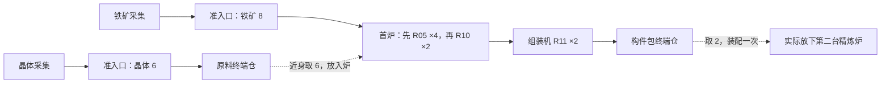
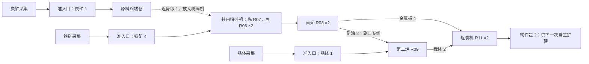

# Factory Production Expansion E1 Layout

更新时间：2026-10-22

## 用途与证据边界

为 [E1 实施合同](../features/factory-production-expansion-e1.md)提供两份坐标布局及同产出比较。**待萝卜SAMA确认，尚未实现或在 Godot 中验证。** 坐标草图是可实施性建议，不是强制玩家照抄的蓝图，也不交付自动建造功能。

本轮只读核对现有 `discovery_rules.gd`、`model.gd`、`logistics.gd`、`power_grid.gd` 与设备取放合同；用 Python 标准库核对提案的足印、相向端口、供电距离、简化通行和配平。原始数据与报告在忽略目录 `tools/runtime-intake/design-references/2026-10-22-e1-contract/`。没有加载 Godot；下列新设备行为仍是拟定合同，不能由纸面检查推定产品通过。

## 共用坐标与接口

原点为足印左上格 `(x,z)`，东为 `+x`、南为 `+z`，区间含首尾。新设备固定朝向，沿现有机器不旋转的规则；只有带 / 附件使用东南西北方向。箭头所指的是物料输出方向。所有布局在初始开放区 `x<4` 内，保留原出生点、样本、两道矿壳和旧六矿点；另增铁矿 `(-28,-12)`、普通炭矿 `(-28,10)`，各一个有效采集位置。

| 设备 | 足印 | 输入：局部格 / 朝外法向 | 输出：局部格 / 朝外法向 |
| --- | --- | --- | --- |
| 采集器（既有） | 2×2 | 无自动输入 | `(1,1)` 东 |
| 终端仓（既有） | 2×2 | `(0,1)` 西 | 无自动输出 |
| 粉碎机 | 2×2 | `(0,1)` 西 | `(1,1)` 东 |
| 精炼炉 | 2×3 | `(0,0)` 西、`(0,2)` 西 | 主口 `(1,0)` 东；副口 `(1,2)` 东 |
| 组装机 | 3×2 | `(0,0)` 西、`(0,1)` 西、`(1,0)` 北 | `(2,1)` 东 |

机器输入口均接受当前配方所需的任一种物料，不把输入口永久绑定原料。精炼炉副口只出矿渣，主口出金属板 / 载体；未产生矿渣的配方不要求连接副口。第三组装输入口留给后续三原料配方，E1 不强制使用。

| 稳定名 | 类型 | A 坐标 | B 坐标 / 差异 |
| --- | --- | --- | --- |
| I / Q | 铁矿 / 晶体采集器 | `(-28,-12)` / `(-20,-1)` | 保留 |
| K | 炭矿采集器 | 未放置 | `(-28,10)`，用预配构件 |
| F | 首台精炼炉 | `(-18,-11)` | 保留 |
| R | 第二台精炼炉 | 完成两包后放在 `(-12,-5)` | 同位置烧结矿渣 |
| C | 粉碎机 | 未放置 | `(-23,-12)`，用预配构件 |
| A | 组装机 | `(-6,-11)` | 保留 |
| T | 构件包终端仓 | `(-1,-11)` | 保留 |
| U | 原料终端仓 | `(-15,-1)`，晶体暂存 | 空仓回收并移至 `(-23,10)`，炭矿暂存 |
| S1 / S2 | 封装电源 | `(-26,-17)` / `(-6,-6)` | 保留，各 120 kW |
| N1 / N2 / N3 | 配电节点 | `(-21,-6)` / `(-12,-9)` / `(-24,1)` | 保留 |
| N4 | 配电节点 | 未放置 | `(-26,6)` |
| GI / GQ | 原料准入口（均朝东） | `(-26,-11)` / `(-18,0)` | 保留，空载重新配置本轮总额 |
| GK | 炭矿准入口（朝东） | 未放置 | `(-26,11)` |

## 布局 A：首次两包构件与第二台炉



下图是生产两包时的占格；第二台炉位置见坐标表，尚未画成已拥有。`I/Q/K` 为采集器，`F/R` 为两炉，`C` 为粉碎机，`A` 为组装机，`T/U` 为仓，`S` 电源、`n` 节点、`g` 准入口，`.` 空地，箭头为带。同字母重复表示多格足印。

```text
x = -28 … 0（每字符一格；上北下南）
-17 ..SSS........................
-16 ..SSS........................
-15 ..SSS........................
-14 .............................
-13 .............................
-12 II...........................
-11 IIg>>>>>>>FF>>>>>>>>>>AAA..TT
-10 ..........FF..........AAA>>TT
 -9 ..........FF....n............
 -8 .............................
 -7 .............................
 -6 .......n..............SSS....
 -5 ......................SSS....
 -4 ......................SSS....
 -3 .............................
 -2 .............................
 -1 ........QQ...UU..............
  0 ........QQg>>UU..............
  1 ....n........................
```

| 带段 | 精确格位 | 方向 | 数量 |
| --- | --- | --- | --- |
| GI → F | `(x,-11)`，`x=-25..-19` | 东 | 7 |
| F 主口 → A | `(x,-11)`，`x=-16..-7` | 东 | 10 |
| A → T | `(-3,-10)`、`(-2,-10)` | 东 | 2 |
| GQ → U | `(-17,0)`、`(-16,0)` | 东 | 2 |

**从零物料起步的操作：**

1. 放置表中 A 的设施，F 默认 R05，A 默认 R11；GI 配铁矿 8、GQ 配晶体 6，启用后自然采集。铁矿与晶体并行备料，仓库只暂存晶体，不向炉自动发货。
2. F 做四批板材，四板沿主口运往组装机的板材输入缓冲。GI 到 8/8 后停止新接收，等炉输入 / 在制 / 输出清空，再把 F 切成 R10；板材可以仍在带上，不必等四板全到组装机。
3. U 已收到六晶体后，近身“取全部”，走到 F“放全部”。两批直接烧结共出两载体，经同一主口 / 同一组装输入口进入 A；不用重铺这条带，也不用取回已投入组装机的板材。
4. A 自然完成两包，进入 T 后近身取全部；建造菜单消耗背包两包装配一台精炼炉，再实际放在 R 位。装配库存增加还不算目标完成，必须放置成功。

组装机按原料分别保留两批容量：四板与两载体不挤占彼此；首炉晶体输入容量六。首次共 **3 次物料转移**（取晶体、放晶体、取构件包）、**1 次炉配方切换**；另有 2 次准入口配置 / 2 次启用、1 次构件装配及 1 次新炉放置。计数按成功权威命令，不含打开面板、选物品或步行，不等于鼠标点击数。

## 布局 B：两炉分工后的混料回用



```text
x = -28 … 0（每字符一格；上北下南）
-17 ..SSS........................
-16 ..SSS........................
-15 ..SSS........................
-14 .............................
-13 .............................
-12 II...CC......................
-11 IIg>>CC>>>FF>>>>>>>>>>AAA..TT
-10 ..........FF......>>>>AAA>>TT
 -9 ..........FF>>v.n.^..........
 -8 ..............v...^..........
 -7 ..............v...^..........
 -6 .......n......v...^...SSS....
 -5 ..............>>RR^...SSS....
 -4 ................RR....SSS....
 -3 ..............>>RR...........
 -2 ..............^..............
 -1 ........QQ....^..............
  0 ........QQg>>>^..............
  1 ....n........................
  2 .............................
  3 .............................
  4 .............................
  5 .............................
  6 ..n..........................
  7 .............................
  8 .............................
  9 .............................
 10 KK...UU......................
 11 KKg>>UU......................
```

| 带段 | 精确格位 | 方向 | 数量 |
| --- | --- | --- | --- |
| GI → C；C → F | `(x,-11)`，`x=-25,-24,-21,-20,-19` | 东 | 5 |
| F 主口 → A；A → T | 与 A 相同 | 东 | 12 |
| F 副口 → R | `(-16,-9),(-15,-9)`；`(-14,z),z=-9..-6`；`(-14,-5),(-13,-5)` | 东；南；东 | 8 |
| R 主口 → A | `(-10,z),z=-5..-9`；`(x,-10),x=-10..-7` | 北；东 | 9 |
| GQ → R | `(x,0),x=-17..-15`；`(-14,z),z=0,-1,-2`；`(-14,-3),(-13,-3)` | 东；北；东 | 8 |
| GK → U | `(-25,11),(-24,11)` | 东 | 2 |

**从 A 接续施工：**两包已装配 R，构件包归零。保留既有主线、两电源和三节点；先显式关闭 GI/GQ 的接收，再确认两闸及旧料带排空、U 为空，回收 `(-23,-11),(-22,-11)` 两段带以放 C，将 U 移至炭矿侧。新增 25 段带、回收 2 段，净增 23；另放预配 K、N4、GK。没有拆除在产设备、丢掉矿渣或免费生成第二套加工设施。

首次 B 设置 F=R08、R=R09、C=R07；GI 改铁矿 4 后先保持关闭，GQ 改晶体 1，GK 配炭矿 1。GQ/GK 开启，U 收到一炭后近身取全部并放进 C。R07 出两炭粉，沿 C→F 进入 F 的炭粉输入；等 C 输入 / 在制 / 输出清空，改为 R06 并开启 GI。四铁矿制六铁粉，同一路径供 F；两批 R08 产生四板、两渣，R09 用两渣和一晶体做两载体，全部进入 R11。

初次 B 仍有 **3 次物料转移**（取炭、放炭、取包）和 **1 次批内换配方**（C：R07→R06），此外还有 **3 次一次性设备配方设置**（F、R、C）、2 次旧准入口关闭、3 次配置 / 3 次启用。完成后重复 B，每两包需把 C 从 R06 改回 R07 再切回 R06，即 **2 次切换**，并先关闭三闸，再空载重置 / 分时启用。A 重复生产也需 R10→R05→R10 两次切换，但只关闭 / 重置两闸。配额用完不等于 accepting 变为 false；配置 / 重置保留接收开关，必须先关闭以避免提前投错工序。重置不允许清掉尾货。

B 消除了两种精炼工艺争用一炉，**没有消除共用粉碎机的人工换料**。下一笔两包可由玩家选择制造第二台粉碎机，使炭粉与铁粉分线；那需要新的布局和真实电力评估，不包含在本图的设备数 / 吞吐中，也不是 E1 强制第三目标。

## 同样两包构件的成本比较

| 指标 | A：首炉直接工艺 | B：两炉混料回用 |
| --- | --- | --- |
| 净投入 | 铁矿 8、晶体 6 | 铁矿 4、炭矿 1、晶体 1 |
| 工序 | R05×4、R10×2、R11×2 | R07×1、R06×2、R08×2、R09×1、R11×2 |
| 目标产出 / 剩余副产物 | 两包 / 0 | 两包 / 0 |
| 生产设备（不含仓 / 电源） | 2 采集、1 炉、1 组装 | 3 采集、1 粉碎、2 炉、1 组装 |
| 带 / 准入口 / 配电节点 | 21 / 2 / 3 | 44 / 3 / 4 |
| 仓 / 封装电源 | 2 / 2 | 2 / 2 |
| 已放置实体 / 占用格 | 34 / 72；放下第二炉后 35 / 78 | 62 / 111 |
| 布局外包矩形（含通路 / 空地） | 29×19=551 格 | 29×29=841 格 |
| 加工能耗 | 3,680 kJ | 2,840 kJ |
| 对应目标原料采集能耗 | 280 kJ | 500 kJ |
| 加工 + 目标采集 | 3,960 kJ | 3,340 kJ |
| 并发请求上界 / 装机 | 140 / 240 kW | 240 / 240 kW |
| 从本包零构件包起累计装配支出 | 收尾消耗 2 包，得到第二炉 | 已支付同一笔 2 包，不重复计价；本轮新产两包可自选用途 |

这里只核对**目标投料**。准入口截停后上游采集器仍会继续填自身最多 50 件缓冲，未投入原料仍是世界库存，不能删掉或计成构件配方的消耗。若自然等待使其额外采集，全厂电量也会高于本表；不是“零剩余物料”或全厂实测能耗。

B 少用 50% 铁矿、约 83% 晶体，但增加一炭矿；材料不是同价币，不能把不同矿物简单求和宣称价值下降多少。加工用能降低约 23%，连同目标采集降低约 16%；面积、建线、配方操作和炭竞争都增加。

**构件账：**预配合计 165 件。A 建线从预配领用 34 件，不消费构件包；装配第二炉后总拥有 166、已放置 35、未放置 131。B 总拥有仍为 166、已放置 62、未放置 104；余下带 84、节点 8、准入口 1，另有反应器 1、仓 2、分流器 4、汇合器 4。所有施工均在供给内。若完全忽略预配、按提案从零制造相同设施，除不可制造的两封装电源外，A 需 20 包、A+第二炉需 22 包、B 需 31 包；B 比 A+第二炉多 9 包的整批构件替代成本，**本次不实际收取这 9 包**。带按每包 8 段向上取整，避免把预配当作无限免费资源。

## 首批等待与持续吞吐

所有时间均为纸面推导，不包含建造、步行、选项操作、暂停或缺电。冷启动比较假设设施已建好、生产进度 / 物料均为零；真实 B 从 A 接续时可能已有矿石缓冲，必须另记库存，不能把这批存货当免费产能。

| 时间口径 | A | B |
| --- | --- | --- |
| 忽略运输与操作的先后约束下限 | 第 2 秒铁料齐；板在 10/18/26/34 秒完成；载体 42/50 秒；两包在 52/62 秒完成 | 第 20 秒采到炭；粉碎炭 26 秒、铁粉 32/38 秒；板 / 渣 42/52 秒；载体 60 秒；两包 70/80 秒 |
| 加入本图带长的首批估算 | 首炉约第 10 秒起工；约第 60 秒首载体到组装；两包入仓约 **83 秒** | 炭约第 23 秒入仓；约第 45 秒首次混料起工；约第 91 秒首载体到组装；两包入仓约 **114 秒** |
| 主要首批等待 | 首炉先做四板，再做载体；主线十格运输 | 炭首次采集、同机分时制粉、两批矿渣凑齐、回用支线运输 |

带长估算采用现有单格 1 秒与 0.05 秒快照补位规则、一个源 / 目标每步最多一次交接；手动操作暂按零耗时计，不是完整自然运行成绩。B 的估算采用炭粉出空后才开启铁矿准入口的清晰操作顺序；不以预先塞满中间品缩短路径。

持续生产必须按**共用机器的总占用**计算：

| 资源 / 工序限制 | A：构件包/分钟上界 | B：构件包/分钟上界 |
| --- | --- | --- |
| 原料采集 | 铁 15、晶体 20 | 铁 30、晶体 120、普通炭 6 |
| 加工时间，不计出空 / 换料 | 共用炉：`60/(2×8+8)=2.5`；组装 6 | 共用粉碎：`120/(2×6+6)=6.67`；混料炉 6；烧结炉 15；组装 6 |
| 多件输出清空后的更紧上界 | 单批只出一件，仍 ≤2.5 | 三粉同口排出至少额外 2.10 秒，两炭粉额外 1.05 秒；共用粉碎 `120/(2×8.10+7.05)≈5.16`；混料炉 ≤`60/11.05≈5.43`（端口轮询可能再多一步） |
| 全线结论 | **≤2.5**，瓶颈是首炉分时占用 | **≤5.16**，瓶颈首先是共用粉碎机，换配方 / 输入重新到齐还会降低产量 |

上述是设备与运输语义的理想上界，**不是可直接兑现的持续速率**。有限两包目标完成后准入口会停；要测持续速率必须另开足量目标、保持有用需求、记录补料与换配方停顿。当前没有零操作自动循环，不能把组装机 6 包/分钟或普通炭支持 6 包/分钟写成整线产能。

二炉直炼的对照也有价值：如果 F 专做 R05、R 专做 R10，原料充足时整线由板材限制为 ≤3.75 包/分钟，仍不需要炭与粉碎；这是设备时间对照，不是第三份已验证布线。B 是否值得，取决于节材 / 扩建目标与操作代价，不能强迫玩家把回用视为唯一升级。

## 供电、通行与故障复原

两图都有连通骨架 `S1—N1—N2—S2`，N3 接 N1；B 的 N4 接 N3。节点间均不超过 12 格，所有设备中心距可用节点不超过 6 格，连线完全位于初始开放区。报告最近距离为 I/C→S1 5.148、Q→N3 4.743、F→N1 5.315、A→S2 5.500、R→N2 5.025、K→N4 4.743 格。

预配反应器在两图均未放置，不能把其负载漏计后声称全厂仍有余量。B 的 240 kW 只是所列设备同时工作的请求上界，不证明持续满载或已有缺电；再加第二粉碎机或反应器后可能出现缺口，实际时序留 E2 验证。

建议从出生点接 `z=4` 横向服务廊：F 可由 `(-16.5,4)→(-16.5,-7)` 近身；C 从该点经 `(-23.5,-7)→(-23.5,-10)`；R 由 `(-11,4)→(-11,-1)`；A/T 从 `x=1.5` 东侧通道接近。原料采集可经西侧 `x=-29.5` 绕行。不要穿电源、节点、仓或附件；带可步行。纸面检查以 0.3 格膨胀足印和半格搜索确认全部设备有两格内的可达操作点，并对所列折线按至多 0.1 格间距采样；尚未验证角色实际运动、镜头输入和施工时站位。

- 副口断带：F 留住矿渣，主口即使已出板也不得开始下一批；面板明确“矿渣出口未连接 / 堵塞”。恢复副线后自然续产，不能消失矿渣或把它送主口。
- 下游停扩建：A / T 积压后整线回压是允许的结果；玩家可关闭准入口停供。回用只在板材与载体都有需求时闭合，不能外推为能源线的永久消纳。
- 错料 / 换配方：矿料混入粉碎出口、C 有在制或余料时拒绝错误操作，给出具体原因；两图不依赖自动清空、自动选料或远程仓取料。
- 实现后必须重验每个端口、原料配额尾件、角色到点和原图；任何端口 / 足印改动同步修改本表与当批检查数据。
