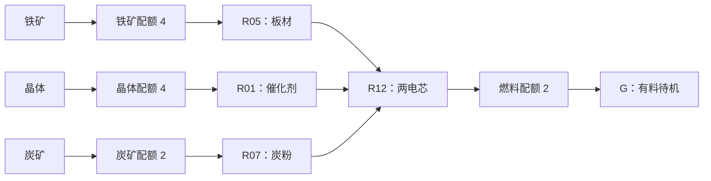
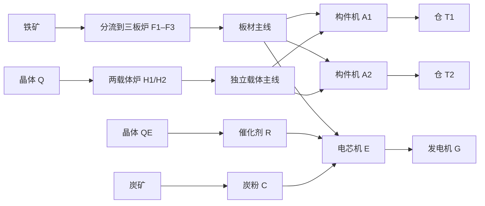

# Factory Production Expansion E2 Layout

更新时间：2026-10-23

## 用途、约定与证据

[E2 合同](../features/factory-production-expansion-e2.md)的 C 紧凑启动、P 自动备建、D 扩建负载和 D+ 第二机布局；功率与原料见[能量收支](factory-production-expansion-e2-energy-balance.md)。**已按确认合同实现，并通过正式 Boot 自然建造 / 生产及独立恢复验证。** 是用于验证可建性和玩家路径的样板，不提供自动蓝图，也不要求玩家拆掉全部旧厂照抄。

坐标为足印左上角 `(x,z)`，东 `+x`、南 `+z`；所有占格位于初始开放区 `-32≤x<4、-32≤z<32`。保留原矿点 / 样本 / 出生位置，使用原 `(-20,-13)、(-20,-1)、(-20,11)` 晶体点及 E1 铁 / 炭点；没有凭空新增矿产、绕过开路或制造第二套封装电源。

折线路径包括起止格及中间每一整数格，按箭头顺序输出；末格指向表中接收端口。路径上指定的分流器 / 汇合器替换同格带，不叠放、不重复计数。未连分支保持空地，输送带不能在格上交叉；机器不能旋转。

| 设备 | 足印 | 输入局部格 / 朝外法向 | 输出局部格 / 朝外法向 |
| --- | --- | --- | --- |
| 采集器 | 2×2 | 无 | `(1,1)` 东 |
| 反应器 | 3×3 | `(0,2)` 西 | `(2,2)` 东 |
| 粉碎机 | 2×2 | `(0,1)` 西 | `(1,1)` 东 |
| 精炼炉 | 2×3 | `(0,0)` 西、`(0,2)` 西 | `(1,0)` 东；副口 `(1,2)` 东 |
| 组装机 | 3×2 | `(0,0)` 西、`(0,1)` 西、`(1,0)` 北 | `(2,1)` 东 |
| 终端仓 / G | 2×2 | `(0,1)` 西 | 无 |

G 的新增端口已实现，其余沿既有设备；全部端口已与现行代码核对。输入口接受该配方所需任一物料，以下分线是布局选择，不把物料永久绑定某口；C/P/D 均采用直炼 / 直接烧结，不产生矿渣，空副口不构成故障。

## C：复用设备启动电芯线

C 的机器在已有 E1 库存内，只额外制造 G（3 包）。若已按 E1 制造第二炉，闲置的第二炉仍留在构件库存，总拥有量为 167；几何计算中从 165 起步只算 G 的最低总额 166，不能据此删除已经制造的炉。

| 名称 | 类型 / 配方 | 坐标 |
| --- | --- | --- |
| I / Q / K | 铁 / 晶体 / 炭采集 | `(-28,-12)` / `(-20,-1)` / `(-28,10)` |
| F / R / C | 炉 R05 / 反应器 R01 / 粉碎 R07 | `(-23,-11)` / `(-17,-2)` / `(-24,10)` |
| E / G | 电芯组装 R12 / 发电机 | `(-13,-11)` / `(-8,-11)` |
| S1 / S2 | 两封装电源 | `(-26,-17)` / `(-3,-6)` |
| N1–N4 | 配电节点 | `(-23,-6)`、`(-13,-5)`、`(-23,3)`、`(-26,6)` |
| GI / GQ / GK / GF | 朝东准入口 | `(-26,-11)`、`(-18,0)`、`(-26,11)`、`(-10,-10)` |

| 带路 | 折线（包括中间格） | 接收目标 | 带数 |
| --- | --- | --- | ---: |
| GI→F | `(-25,-11)→(-24,-11)` | F 西上输入 | 2 |
| F→E | `(-21,-11)→(-14,-11)` | E 西上输入 | 8 |
| R→E | `(-14,0)→(-14,-10)` | E 西下输入 | 11 |
| GK→C | `(-25,11)` | C 西输入 | 1 |
| C→E | `(-22,11)→(-6,11)→(-6,-13)→(-12,-13)→(-12,-12)` | E 北输入 | 48 |
| GF→G | `(-9,-10)` | G 西输入 | 1 |

Q 经 GQ 直接进 R，E 直接出至 GF，不补虚构带段。总带 71、在场实体 89、占格 138；4 个准入口均取预配。C 三料线路有意分开，炭粉绕东侧避开机器和其他料线；代价是冷启动等待较长，不把这个长绕线当成最优工厂或吞吐保证。

两电芯需要两板、四炭粉、两催化剂。按合同先停 G、实际自然供料，确认到货后启用；C 请求上限 220 kW，G 应保持有料待机。E 从 G 节点接入同网基础电源，空 G 必须仍可导通，否则此布局不能自举。

## P：两炉分工，自动制造扩建构件

P 先使用 D 的 `I、Q、F1、H1、A1、T1、S1、S2、N1–N9、GI、GQ` 坐标，其余暂不放；F1 做板，H1 直接烧结，A1 做构件。无需新增第二套加工供给，第二炉来自已完成 E1 的真实制造。已有 C 的 G 可留在构件库存，不能在阶段切换时减掉制造账。

| 带路 | 折线 | 末端去向 | 带数 |
| --- | --- | --- | ---: |
| 铁矿 | `(-25,-11)→(-25,-9)→(-30,-9)→(-30,-29)→(-28,-29)` | F1 西上输入 | 30 |
| 板材 | `(-25,-29)→(-23,-29)→(-23,-8)→(-22,-8)→(-22,-5)→(-17,-5)` | A1 西上输入 | 33 |
| 晶体 | `(-17,-12)→(-17,-25)→(-16,-25)` | H1 西上输入 | 15 |
| 载体 | `(-13,-25)→(-8,-25)→(-8,-6)→(-15,-6)` | A1 北输入 | 32 |
| 构件 | `(-13,-4)→(-12,-4)` | T1 西输入 | 2 |

共 112 带、131 实体、占格 171，不需额外带 / 物流附件制造。路径中的将来分支暂用普通带；两输入分别输板 / 载体，避免比例不匹配的混料总线堵死另一种原料。P 最大同时请求 200 kW，实际稳态不超过单板炉支持的 3.75 包/分钟。玩家只需配置原料目标、取成品并制造，无批内切配方。

P 扩成 D 时保留两炉、第一构件机与全部原料主干，在清空的指定格原位换附件、延长两种中间品主线，再增加其余设备。原路径下游改接前须停收 / 排空或按现有回收规则取回全部货物，不销毁材料。正式驱动必须记录中途持有与制造账，不能直接加载满库存的 D 冒充自然建成。

## D：一台发电机与真实扩建负载

增加独立 QE 采集器，使能源晶体不经过载体主线；该第四采集器必须花两包制造，不从原三件供给中重复计数。板材先向两构件机分流，缓冲回压后继续向 E；这不是优先供能策略，实际过渡期可能暂缺板，恢复时依合同停机形成保证不超过 220 kW 的能源子线。

| 名称 | 类型 / 配方 | 坐标 |
| --- | --- | --- |
| I / Q / K / QE | 铁 / 构件晶体 / 炭 / 能源晶体采集 | `(-28,-12)` / `(-20,-13)` / `(-28,10)` / `(-20,11)` |
| F1 / F2 / F3 | 板材炉 R05 | `(-27,-29)` / `(-27,-24)` / `(-27,-19)` |
| H1 / H2 | 载体炉 R10 | `(-15,-25)` / `(-15,-19)` |
| A1 / A2 / E | 两 R11 与一 R12 | `(-16,-5)` / `(-16,1)` / `(-6,13)` |
| C / R / G | R07 / R01 / 发电机 | `(-24,10)` / `(-15,13)` / `(-1,13)` |
| T1 / T2 | 构件终端仓 | `(-11,-5)` / `(-11,1)` |
| S1 / S2 | 封装电源 | `(-29,-6)` / `(-10,5)` |
| N1–N4 | 节点 | `(-25,-28)`、`(-25,-21)`、`(-18,-28)`、`(-12,-23)` |
| N5–N8 | 节点 | `(-12,-13)`、`(-24,-10)`、`(-16,-9)`、`(-18,-2)` |
| N9–N12 | 节点 | `(-16,5)`、`(-25,6)`、`(-12,11)`、`(-21,15)` |
| GI / GQ / GK / GQE / GF | 朝东准入口 | `(-26,-11)` / `(-18,-12)` / `(-26,11)` / `(-18,12)` / `(-2,14)` |

### D 的全部带路

下表“格数”包含路径上会被附件替换的格；原始路径总格数 215，替换 6 分流、3 汇合、1 准入口后，实际带为 **205**。其余 4 准入口独立列在上表，不属于路径带数。

| 路由 | 折线 | 接收端口 | 格数 |
| --- | --- | --- | ---: |
| 铁矿主路 | `(-25,-11)→(-25,-9)→(-30,-9)→(-30,-29)→(-28,-29)` | F1 西上 | 30 |
| 铁矿支路，各 2 | `(-29,z)→(-28,z)`，`z=-24,-19` | F2 / F3 西上 | 4 |
| 板材主路 | `(-25,-29)→(-23,-29)→(-23,-8)→(-22,-8)→(-22,9)→(-5,9)→(-5,12)` | E 北口 | 62 |
| 板材汇入，各 2 | `(-25,z)→(-24,z)`，`z=-24,-19` | 两汇合器 | 4 |
| 板材支路，各 5 | `(-21,z)→(-17,z)`，`z=-5,1` | A1 / A2 西上 | 10 |
| 载体晶体主路 | `(-17,-12)→(-17,-25)→(-16,-25)` | H1 西上 | 15 |
| H2 晶体支路 | `(-16,-19)` | H2 西上 | 1 |
| QE→R | `(-17,12)→(-17,15)→(-16,15)` | R 西输入 | 5 |
| 载体主路 | `(-13,-25)→(-8,-25)→(-8,0)→(-15,0)` | A2 北口 | 38 |
| H2 载体汇入 | `(-13,-19)→(-9,-19)` | 载体汇合器 | 5 |
| A1 载体支路 | `(-9,-6)→(-15,-6)` | A1 北口 | 7 |
| 两构件出仓，各 2 | `(-13,z)→(-12,z)`，`z=-4,2` | T1 / T2 西输入 | 4 |
| GK→C | `(-25,11)` | C 西输入 | 1 |
| C→E | `(-22,11)→(-22,10)→(-7,10)→(-7,13)` | E 西上 | 20 |
| R→E | `(-12,15)→(-7,15)→(-7,14)` | E 西下 | 7 |
| E→G | `(-3,14)→(-2,14)` | G 西输入 | 2 |

| 替换附件 | 格位与朝向 | 实际分支 / 汇流 |
| --- | --- | --- |
| SI2 / SI3 分流 | `(-30,-24)` / `(-30,-19)`，北 | 前向继续北上，右向喂对应板炉 |
| MI2 / MI3 汇合 | `(-23,-24)` / `(-23,-19)`，南 | 北来的板与西侧本炉板合流 |
| SP1 / SP2 分流 | `(-22,-5)` / `(-22,1)`，南 | 前向继续能源线，左向喂构件机 |
| SH2 分流 | `(-17,-19)`，北 | 前向 H1，右向 H2 |
| MH2 汇合 | `(-8,-19)`，南 | H1 / H2 载体汇流 |
| SC1 分流 | `(-8,-6)`，南 | 前向 A2，右向 A1 |
| GF 准入口 | `(-2,14)`，东 | 电芯通过后才计燃料配额 |

P→D 不再需要混料矿渣与共用粉碎机换料：此样板选择耗铁较多但供能无副产物的直炼。混料工艺仍可由玩家选用，但不能把其矿渣送入已满载体链后宣称已解决持续能源副产物问题。

### 构件和预算

| 类型 | D 在场 | 初始供给 | 累计需制造 | 包成本 |
| --- | ---: | ---: | ---: | ---: |
| 采集器 | 4 | 3 | 1 | 2 |
| 精炼炉 | 5 | 1 | 4 | 8 |
| 组装机 | 3 | 1 | 2 | 4 |
| 发电机 | 1 | 0 | 1 | 3 |
| 准入口 | 5 | 4 | 1 | 1 |
| 分流器 | 6 | 4 | 2 | 2 |
| 带 | 205 | 128 | 10 批 ×8 =80 | 10 |
| 反应器 / 粉碎 / 终端仓 | 1 / 1 / 2 | 1 / 1 / 4 | 0 | 0 |
| 封装电源 / 节点 / 汇合器 | 2 / 12 / 3 | 2 / 12 / 4 | 0 | 0 |
| **合计** | **250 实体** | **165 构件** | **91 件新增构件** | **30 包** |

总拥有量 **256**，场上 250；库存余 3 段带、2 仓、1 汇合器，仍占预算。占格 338，矩形范围 `x=-30..0、z=-29..15`，总拥有量余 70。不是将 326 改为仅场上上限；闲置 / 拆回的构件和已经制造的额外物品必须继续计账。

## D+：把新增四包用于第二台发电机

从 D 实际做出并取走 4 包，制造第二 G（3 包）与分流器（1 包）。停收、排空 GF 与这段带后，将 GF 移到 `(-3,14)`，在原 GF 格 `(-2,14)` 放朝东分流器；前向直接进入 G1，右向新增带 `(-2,15)→(-2,18)`，末格朝东进入 G2 `(-1,17)` 的西输入。

原 `(-3,14)` 带拆回一段，新路用四段，净增三段正好使用 D 的余带；G2 与 G1 中心距四格，同网。最终带 208、分流 7、发电机 2，在场 255、占格 346、总拥有量 **258**，剩 2 仓 / 1 汇合器；累计制造 **34 包**。运行共用燃料闸的到货轮询，未新增远程燃料转移或优先供能功能。

## 验证结果与边界

离线证据根：`tools/runtime-intake/design-references/2026-10-23-e2-contract/`。四个布局核对足印无重叠、初始区域范围、每个在用输出的相向输入、节点同网与消费者 6 格内；炉副口本次未产矿渣、分流空分支不计应连端口。按所有非带实体外扩 0.3 格，在半格网格上核对从出生附近到每个操作对象两格内的通路；它比现有 0.29 圆角碰撞保守，但不能替代实际 WASD 与镜头 / 点击。

| 样板 | 在场实体 / 占格 | 实际带 | 在用输出连接 | 最大最近节点距离 |
| --- | --- | ---: | ---: | ---: |
| C | 89 / 138 | 71 | 82 | 5.148 格 |
| P | 131 / 171 | 112 | 119 | 4.950 格 |
| D | 250 / 338 | 205 | 239 | 5.590 格 |
| D+ | 255 / 346 | 208 | 244 | 5.590 格 |

上表仅是离线几何证据，不证明物流吞吐或玩家耗时。10 月 23 日实现的 `factory_energy_layout.gd` 与本页 C/P/D/D+ 坐标一致；正式 Boot 已从零材料经真实制造和回收搬迁逐步建成，完成同源供电对照、双机耗尽恢复与独立存读，批次见 [W43](../devlogs/2026-W43.md)。SP1 / SP2 的到货顺序、长带填充和停收尾货仍会影响过渡期；C→D 的自动工程操作约 16.4 分钟，不代表新手建造耗时或最优布局。下一步优先短试玩首次收益与操作成本，不要求玩家重抄完整样板。
